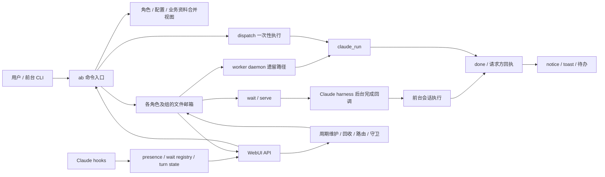
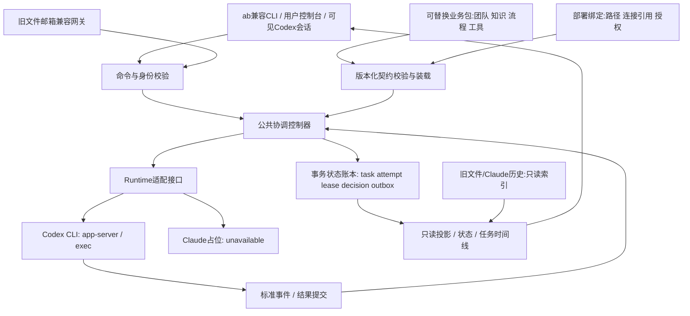

# MasterAgent 3.0：通用在线 Agent 协作基座审查与升级设计

审查日期：2026-10-08（Asia/Shanghai）  
项目：`C:\apphome\agent_fleet`  
审查基点：`master` / `0d1ab7c`；问题清单对应实施前旧代码，3.0新增实现及证据另记进度文档。  
状态：用户已要求开始实施并继续；业务可替换基础、公共协作核心及Codex单次文本执行入口已落地，真实调用待专用登录验证，旧运行环境未切换。
补充要求（2026-10-08）：用户明确要求业务与基座分离、业务可替换；本次将其提升为重构主线和前置验收条件。
目标版本：**3.0**（用户指定，当前开发标记 `3.0.0-dev.3`，未发布）；Astra仍指本次主力模型，不作为平台版本号。
当前会话角色：**MasterAgent**（用户明确指定），承担平台基座演进职责。

## 1. 主要结论与推荐顺序

**目标是业务可替换的在线 Agent 协作基座：基座提供身份、通信、执行协调、用户介入和恢复，业务包提供团队、知识、流程与工具。Codex 是当前执行运行时。业务分离与运行时分离是两条独立边界，都必须成立。**

**业务可替换已是用户明确要求，不再列为可选优化。** 同一平台构建应能空载启动、安装业务 A、停用 A 后切换完全不同的业务 B，并显式恢复 A；不改基座代码，不让 B 继承 A 的知识、角色状态、权限或会话。现状只完成部分文件外迁和合并读视图，尚未达到这一标准，见第 3.2、7.6、9.3 节。“任意换”指遵守版本化业务契约的任意业务；新增外部系统可编写业务适配器，但不能要求修改基座分支。

1. **先建立隔离基线，同时把业务可替换做成独立主线。** 现有冒烟会写真实总线，甚至强制释放共享锁；启动 WebUI 会自动回收、归档、派提醒。先隔离验证环境，再落实业务包、部署绑定和运行态的职责分离。第二阶段必须通过基础换域，第三阶段必须通过在飞任务、迟到事件和故障恢复下的换域，不能只搬目录后转去接 Codex。
2. **优先解决协作正确性。** 已核实任务完成缺少 attempt/lease 所有权校验，回收与完成跨多个文件，部分终态和投递失败被当作成功或吞掉。换运行时之前需要统一 Task / Attempt / Lease / Result / Decision 契约。
3. **纠正“在线”的含义。** 已知孤儿 wait 仍可被标为 `armed` 并推荐接单；进程存活、会话可控、消息已送达、模型开始处理和有空闲容量必须分别表达。
4. **推荐渐进引入单一协调控制器与事务化状态账本，首选 SQLite。** 保留 `ab` 和文件邮箱作为兼容入口，历史文件先只读保留；只把新协调状态的写入权收口。纯文件单写者加持久日志是可行的最小替代方案，见第 7 节，不先做全量数据迁移。
5. **Codex 默认执行路线分两步。** `codex exec --json` 先验证一条完整任务闭环；持续在线成员以 Codex CLI 的 app-server 接口为推荐接入方向，验证消息、审批、纠偏、中断、恢复与前台可见性。一次性后台命令成功不等于在线团队验收通过。
6. **按价值收敛功能。** 保留角色与专长、通信、任务、用户介入、恢复、基本观测；合并重复状态计算、回填和维护机制。语音、长程图、复杂画像独立为可选扩展；休眠弹性派发器、Claude 特定自醒补丁和过时兼容分支是有条件的退役候选。
7. **不等待 Claude 恢复。** Claude 当前不可用是本轮前提。其历史会话、用量和知识按价值保留；未来适配器只有接口与 `unavailable` 能力声明。本次所有真实执行验收用 Codex，Astra 是本次主力模型而非平台唯一模型。

推荐实施顺序：**隔离基线与业务边界 → 同构建空载 / A→B→A → 带业务归属的协作与所有权契约 → Codex 接入与持续协作 → 故障及真实换域验证 → 分批迁移交接**。保留六阶段组织方式；业务可替换贯穿各阶段，在 Codex 接入前先用运行时替身证明，而非最后补做。

### 1.1 MasterAgent职责承接与3.0定位

用户已明确指定当前会话承担MasterAgent角色。角色依据为 `CLAUDE.md:19-25` 与 `role_profiles.json` 中MasterAgent定义：负责agent_fleet协调基础设施自身的演进，包括总线、控制台、执行监督、通知、记忆与恢复、版本发布和跨实例演进交接。当前会话据此对3.0的架构、任务拆分、实现推进、验证、迁移与文档交接承担统筹责任；实际动作范围仍按各阶段授权执行。

**3.0定位：业务可替换、以Codex为当前执行运行时的通用在线Agent协作基座。** 三条验收主线是业务与基座彻底分离、团队协作状态与执行结果可信、运行时通过明确契约接入。业务团队及业务Master消费基座，MasterAgent负责基座质量与演进；基座无需某个指定角色持续在线才能完成调度、收信或恢复。

保留角色中的主动维护、变更影响分析、验证与回退、消费者交接和版本记录职责。具体消费者从部署关系确定；历史上固定向Master通报、调用Claude恢复或绑定旧bus的操作不直接成为3.0依赖。真实发版时提供变更说明、迁移/回退指引及适用的fork_exchange交接；本次确定3.0目标不触发打tag、发布或旧平台注册。

## 2. 调查范围、证据等级与当前快照

### 2.1 本轮实际做了什么

以下四项记录原只读审查阶段。用户后续发出“开始做起来”后，已新增独立3.0入口与合成验收，详情见第13.1节及 `docs/MASTERAGENT_3_PROGRESS.md`；未调用旧bus或真实模型。

- 阅读 README、AGENTS、CLAUDE 中的架构/操作约定，以及架构地图、边界、分离、自醒、恢复、工作态文档；核对 bus、执行器、hooks、UI/API、启动脚本和测试源码。初次审查未根据旧文档自动认领角色；随后用户明确指定当前会话为MasterAgent，职责承接见第1.1节。本轮没有连接或注册旧团队。
- 检查 Git 状态、链接元数据、少量运行态文件元数据；只对 `events.jsonl` 最后 1 MiB 在本机聚合事件种类和时间，未输出任务正文、结果或个人会话内容。未读取队列业务正文、完整会话历史、音频、数据库内容或认证文件；宿主 settings 快照没有展开。源码中偶遇敏感连接示例只记位置，不收录值、不验证其有效性。
- 查阅当前官方 Codex 文档；本机仅运行版本/帮助和静态协议 schema 生成。没有启动 Codex 执行会话、app-server 服务或做模型调用，也没有检验账号额度、模型访问权和沙盒执行效果。
- 未运行 `ab`、`recover.py`、任何现有冒烟/场景测试或 HTTP API；未启动、停止、重启服务，未注册、派单、清理运行态，未提交或推送。

证据标记：**实证**指代码分支或本次只读元数据已核实；**风险**指由代码推导的失败场景，尚未隔离复现；**历史**指有日期的文档/提交记录；**待确认**指缺少真实使用或运行验证。源码证明某分支有问题，不等于本轮观察到了线上事故。

### 2.2 工作区与有限运行证据

| 项目 | 本次观察 | 解释与局限 |
|---|---|---|
| 既有工作区修改 | `BUS_ONBOARDING.md` 已修改（新增 8 行）；`docs/prompts/` 未跟踪 | 均保留；新增内容涉及 FYI/回执纪律及文稿提交约束，不应被格式化或覆盖 |
| 注册角色 / daemon 期望 | `agents.json` 22 个角色；`fleet.json` 的 `daemons=[]` | 空 fleet 是当前配置；不能沿用旧文档的“5 个 daemon” |
| 队列文件计数 | 22 个注册角色合计 inbox 0、processing 0、done 87、failed 0、archive 10,005、done_archive 8,992 | 2026-10-08 14:49:59 的目录计数；未读正文，不含所有退役/未知/组队列；不表示无需保留历史 |
| 持久状态标签 | presence：21 个 `listening`、1 个 `stopped`；20 个 wait registry 留有 `listening` | 只是落盘标签。presence 文件修改时间跨度为 08-31 至 10-08 09:58；wait registry 最后修改约 09:58，不能作为 14:49 可接单证明 |
| 进程名快照 | 精确名称查询未返回 `claude`、`python`、`pythonw`，返回 6 个 `codex` | 未取其他会话 cwd/命令行；进程名快照不等于完整服务探测，更不能把本次 Codex 进程计作平台成员 |
| 审计尾部 | 覆盖时间字段 09-17 17:15 至 10-07 19:01；有 send 842、claim 1,247、done 1,476、rearm 1,165、selfwake_guard 1,939、ask_user 3、answer 2 | 截尾、混合事件、可能含测试；不能据此计算成功率或真实功能使用频率。组/退役/锁/探针等也有事件，但可能由 smoke 产生 |
| 运行资产 | events 约 7.7 MB；usage.db 约 61 MB；metrics 最后修改 08-27；tasklines 最后修改 08-27 | 只看文件属性。说明有历史资产，不证明内容完整，也不能因较久未改判定功能可删 |

### 2.3 文档与现行行为需要分开

- `README.md` 的“无服务端”只适用于早期文件传递设计：当前 `ui/server.py:154-166` 已承担持续维护控制职责。
- `AGENTS.md` 部分仍描述 6 月前台/daemon 数量；`fleet.json:2-3` 记录 8 月回退且目前为空。`CLAUDE.md` 仍有常驻 daemon 的旧角色叙述。
- `docs/ARCHITECTURE_SOURCE_MAP.md:95-102` 还描述总线硬链镜像；当前真实形态是项目内物理原件、宿主 junction，`sync_code.ps1:11-18` 已在该形态下退出。
- 9 月 23 日业务分离审计列出的全部缺口并非仍未处理：通用锁、profile/caps 合并读取、业务 desc 外迁读视图和 UI 待办去业务种子已有代码。剩余应逐项处理，不能重做已落地部分。
- `config.json:12-14` 仍说明 block 为七天；实际 `bus/config.py:54-58` 返回 `None`，是真无限等待。
- 旧“封板只修不拆”“需 Claude 角色签字”等属于历史运行约定；本次用户明确授权重新设计，且 Claude 不可用，不能用这些旧要求阻塞方案。

## 3. 当前架构与协作链路



图中执行路径是源码支持路径；不表示 Claude 现时可运行，也不表示空 fleet 中有 daemon 正在工作。

| 环节 | 实际实现与消费方 | 边界或缺口 |
|---|---|---|
| 加入 / 注册 | `bus/identity.py`、`roster.py`；hello 更新注册与 presence，打印角色页、caps、记忆指针 | hello 本身不保证接单；培训是软约定，caps 主要是提示内容 |
| 身份绑定 | `proc.py` 找 Claude 祖先进程/会话，`presence.py` 保存 role、PID、session | role、活实例、runtime 和会话没有充分分离；PID/session 回退可能接上旧身份 |
| 上岗监听 | `core.py:471-594` 注册 wait、心跳、自检、等待任务；前台仍依赖 harness 回调 | 外部文件存在与 wait 结束都不能证明模型收到任务；daemon 直接调用 `_wait_core`，不完整经过注册权仲裁 |
| 投递 | `core.py:97-159` 构建任务、写目标 inbox、审计、告警；组路径另在 `pool.py` | 多种入口和角色目录自动创建；未形成统一可校验的调用身份与幂等请求 |
| 领取 | `mailbox.py:15-90` 使用 claim 锁和文件移动，记录 claimed/claim_pid 等 | 能减少正常竞争下重复领取，但不提供跨回收/重试的唯一执行语义 |
| 执行 | 前台遵循提示执行再 done；daemon / dispatch 调 `claude_run.py` | 前台能对话与纠偏；后台逐任务执行，展示 live.log 不等于可交互 |
| 完成 / 结果 | `core.py:661-717` 先写请求方 done，再归档源任务、清 current_task、通知 | 多步非事务；dispatch 又有独立回填实现；没有 attempt fencing |
| Agent 请求应答 | `core.py:615-638` send + 默认有限等待，ID 关联；禁止自请求、chain 软环检查 | 入口未严格验证timeout为有限正值；chain靠调用者透传；超时不代表子任务已取消；回执被消费删除 |
| 用户介入 | `tasks.py` ask-user/answer，`user_checkpoint.py` 跟踪缺席；UI todo 派发/答复 | answer 写回收件人 inbox 后标完成，不等于原任务恢复成功；UI/CLI 写法不统一 |
| 异常恢复 | `health.py` reap/supervise/sweep；`selfwake.py` 守卫；UI 定时驱动 | 角色级探活、turn 线索、TTL 混用于回收，未能确认旧执行已经停止 |
| 会话 / 工作接续 | `sessions.py` 索引 Claude jsonl；`_workstate/README.md`、`claude_run.resolve_continue` | 工作态指针与原生 resume 已有雏形，但缺少版本/完整性契约；不能跨 runtime 原生 resume |
| 退出 / 退役 | park/unpark、关闭前台、stop_worker、`roles.py:29-106` retire/revive | 没有统一 draining；活实例可能继续写；同名退役目录存在时有删除旧归档分支 |

### 3.1 当前状态真相源

| 数据 | 当前来源 | 应如何理解 |
|---|---|---|
| 角色与专长 | agents.json + role_profiles + caps 两表合并 | 部分读方已统一到 `agents_view()`；注册状态、部署名单、业务内容仍混杂 |
| 任务状态 | inbox / processing / failed / archive 文件位置与 JSON 字段 | 文件位置、status、current_task、回执可能在崩溃窗口互相矛盾 |
| 执行体状态 | presence、wait.reg、进程扫描、turn_state、wait_trace | 不是同一份具有所有权约束的事实；`armed` 是推导值 |
| 回执与通知 | 请求方 done、notice、events | 消费/归档会移除查询用证据；通知不应承担执行事实真相源 |
| 待办 / 工作线 / 长程图 | todos、tasklines、longrange net 与 board 投影 | 语义有重叠，跨引用存在但不是跨对象事务 |
| 用量 | metrics、usage.db、宿主 token_stats、events 活动重建 | 统计域不同；不能把任务指标、全部会话用量和活动计数直接相加 |
| UI 状态 | 多个刷新缓存与 fleet_status.json | 派生投影；需展示观测时间和来源，不能倒过来作为领取授权 |

### 3.2 专项复核：为什么目前不能认定业务可替换

既有 A/C/B1 分离有实际价值：通用资源锁、业务 caps/profile 外置、业务 desc 合并读视图已经存在；`docs/PROPOSAL_separation_BC.md` 也明确把业务 agents 条目完全分出的 B2 留作后续。问题在于分离尚未覆盖写入、行为、执行上下文和退出恢复。以下均为源码依据；串域后果是待隔离复现的风险，本轮未切换任何真实业务。

| 边界缺口 | 当前证据 | 换业务时的具体影响 |
|---|---|---|
| 业务定义仍可写回公共注册表 | `roster.py:63-68` 只是只读合并视图；`identity.py:26-29` register 写 `BUS/agents.json` 的 desc；`roles.py:44-45,94-96` 退役/复活继续读写 desc/caps | 外迁说明文本后，注册或复活仍可能把业务定义带回公共表；换掉 profiles 不等于换掉已注册团队 |
| 固定团队组织进入平台流程 | `ui/api.py:1375-1376` 固定以 Master 发单，`:1470` 固定读 Master/done；`roster.py:123` 值守角色降级为 Master/MasterAgent；`identity.py:202-213` 首次上岗创建并投递给培训师 | 不设 Master、培训师的新业务仍可能生成旧角色、错误回执路径和隐式培训任务 |
| 默认执行位置仍指向现业务 | `agent_bus/config.json:5-7` 保存现业务 cwd/repo/memory；`worker_daemon.py:28` 还有业务目录回退；`bus/exec.py:29`、`dispatch_agent.py:66` 消费默认 cwd | 未完整配置的新业务可能进入旧仓库、读取旧知识；将路径做成可选项仍不能消除静默回退 |
| 空载、损坏和旧配置回退混淆 | `roster.py:23-34,41-59` 吞掉加载异常；`:53-54` 找不到业务 profile 时回退旧根文件；`config.py:28-31` 损坏配置变空字典 | 停用 A 后可能读回 A 的旧文件；损坏的 B 被当成正常空载，用户无法判断业务究竟是否装载成功 |
| UI 用现业务特征识别归属 | `ui/api.py:1843,1903` 按固定业务 cwd 片段标识 agent；`:1880-1883` 从标题推断角色；`:2422` 提示词视图默认加入旧业务项目路径 | 全新目录的 B 可能被漏识别；A 的历史、提示词与恢复候选可能继续进入 B 的视图 |
| 状态只有全局 role/resource，缺业务安装归属 | `roster.py:126-127,158-161` 全局 agents 与角色邮箱；`presence.py:23,52,59,83,100-105` 同名 role 继承 cwd/session、会话映射缺业务边界；`lock.py:28-34` 按资源名落锁 | B 的同名角色可能继承 A 会话；A 的未决任务、旧实例、迟到回填和通知没有明确的切换隔离规则 |

`scenario_sepC_empty_biz.py:18-42` 主要验证替换业务注册目录后部分读取不抛异常、业务词消失，再恢复读取；仍使用真实 BUS。它不能证明干净安装、写入分离或 A→B→A 生命周期。后续采用全合成业务和独立状态根，不以删真实业务资料做“空载验证”。

## 4. 功能取舍清单

分类针对能力或实现，不代表本轮删除任何内容。成本为相对维护/改造成本；入口、配置和测试证明功能存在，不自动证明用户仍使用。下面的源路径均相对项目根；bus模块简写（core、roster、presence等）指 `agent_bus/bus/`，UI模块指 `ui/`，执行器脚本指 `agent_bus/`。第13节提供完整路径索引。

| 功能 / 用户场景 | 分类与建议 | 代码、消费方及使用证据 | 证据局限 / 成本 / 理由 |
|---|---|---|---|
| 角色、专长、花名册、路由 | **保留并优化**；稳定 role_id，部署配置与业务档案分开 | identity、roster、roles；hello、route、UI；22 个注册条目 | 有配置和入口，不能据此认定 22 个都需迁入首批；中成本，是团队基本能力 |
| 身份绑定与会话归属 | **优化**；显式实例注册、runtime/session 引用，PID只作辅助证据 | proc、presence、identity；who、resume、hooks、UI | 当前 Claude 识别规则不可复用；高收益、中成本 |
| 在线状态 / 忙碌 / 收信状态 | **保留并重构**；分别展示控制通道、消息确认和执行容量 | selfwake、status、turn_state、UI；审计中有大量守卫/rearm | 守卫次数不是失败率；现有标签确有误报分支；中高成本 |
| 定向派发、领取、回填 | **保留并优化**；统一 task/attempt/lease/result | core、mailbox；所有前后台执行器及UI；send/claim/done审计 | 核心路径有使用证据；缺事务与迟到结果仲裁；高优先 |
| Agent 间 request/reply | **保留并优化**；关联持久化、异步等待状态、超时不冒充取消 | core:315-349,615-638；daemon/前台 prompt | 静态路径完整；调用量未单独核实；中成本，避免协作退化为单向队列 |
| FYI / 完成 notice / toast | **合并**到事件订阅与通知策略；保留必要人工提醒 | notify、core ack-notices、config；UI及协调位；现有用户未提交修改 | 通知/回执不能混为任务；先保语义再减少为收通知而起模型turn；中成本 |
| 待决事项、用户答复、任务恢复 | **保留并合并**；一个 Decision 服务供CLI/UI/runtime消费 | tasks、user_checkpoint、UI todo；尾部有ask_user/answer | 稀少记录含截尾；RMW及重发缺口明确；中成本 |
| 用户缺席提醒 / 自动过期 | **优化，规则需用户确认**；决策与FYI分开 | user_checkpoint；server:88-102；UI待办 | 不能把过期视为同意；高风险原有禁过期意图应保留；低中成本 |
| reap / supervise / selfwake-guard / health-sweep | **合并实现、保留治理能力**；迁独立维护控制器 | health、selfwake、server:50-166；有周期事件 | UI不是治理服务的可靠生命周期；动作需审计/禁用开关；中高成本 |
| 前台可见持续会话 | **核心保留，改用Codex受管会话** | 旧前台协议、在线协作要求、历史daemon回退记录 | 原生TUI与控制器共用会话需隔离验证；可见日志不足以替代纠偏/审批/中断；高价值 |
| worker_daemon 常驻执行器 | **旧Claude实现为退役候选**；抽取有价值的执行监督 | worker_daemon、start/stop_worker；当前fleet为空 | 有明确回退记录；不能推断后台执行永远无价值，也不默认恢复旧fleet；中成本 |
| dispatch 一次性执行 | **保留能力，合并生命周期**到公共执行服务 | bus/exec、dispatch_agent、claude_run；metrics有历史文件 | 任务/结果/通知另写一套导致分叉；中成本，适合明确边界的临时工作 |
| 通用资源互斥 | **保留并优化所有权** | bus/lock；edge别名；pool及并发场景测试；锁事件 | 正常抢锁测试不覆盖接管竞态；需要token/续租/实例级release；中成本 |
| edge-acquire/release 旧别名 | **退役候选，先兼容观察** | bus/edge、agentbus；历史文档及角色流程 | 不能因通用锁已上线就删命令；消费方完成迁移后去实现，历史记录不动；低成本 |
| 工作组、状态路由、fanout/collect | **可选扩展，保留接口价值、收敛双调度** | bus/pool、core、agentbus:165-173、UI组页及smoke | 尾部组事件可能全是测试；需确认默认push还是pull及真实使用；中高成本 |
| pool_dispatcher 自动弹性派发 | **退役候选，建议默认硬禁用** | pool_dispatcher:5-10,99,183-186；明确FUTURE/休眠/先删后启动 | 未证明近期启用，不能称当前事故；有源码丢单路径，不值得先换成Codex继续跑；恢复前须重新验收 |
| 工作态接续 / 角色知识 | **保留并规范化** | _workstate/README、claude_run:64-79、identity角色记忆 | 路径提示不是可验证交接；加schema、产物、版本、未决事项与来源；中成本 |
| Claude 原生历史 / 退役档案 | **保留历史，恢复动作标不可用** | sessions、roles、UI归档恢复；大量归档文件计数 | 不读正文也不能判无价值；Codex仅接续提炼工作态；中成本 |
| Claude hooks：重挂/compact/读过核验 | **拆分：公共意图保留，专属补丁退役候选** | hooks六脚本、bootcheck、session_reads | 未核宿主实际安装；Codex已有独立hooks但不能照搬工具字段和唤醒假设；中成本 |
| 历史用量 / 基本运行统计 | **保留，按runtime与来源分账** | io、UI usage/BI、宿主token_stats；usage.db文件 | 不回算未知价格、不将null补0；ETL从GET移出；中成本 |
| 画像、探针、型号迁移分析、复杂度图 | **可选扩展，使用待确认** | agent_data、probe、complexity_snapshot、UI画像/BI、探针测试 | 入口和测试存在，缺少独立真实采纳证据；可能依赖业务或隐含判据；中高维护成本，先不阻塞核心 |
| tasklines / 长程net / board / 决策合批 | **合并概念，可选扩展** | tasks、longrange_net、UI routes:89,99,226；tasklines文件 | longrange fork明确只是建结构；不是已完成执行DAG。保留规划数据和只读导出，决策并入公共契约；中高成本 |
| ASR 语音、转录、原声回放 | **可选扩展，需要用户确认** | asr_service、UI api:297-445；独立音频/模型依赖 | 未查音频和使用历史；默认存原声与UI内存句柄需独立治理；维护成本高于其对协作核心的贡献 |
| 业务包 / 团队 / 工具 / 知识 / 策略 | **必须分离，前置验收**；从读视图外迁推进到装载、写入、停用与恢复的完整边界 | 第3.2节六类耦合；分离A/BC文档及现有空业务测试 | 用户已明确要求；中高成本，覆盖注册、执行、UI、状态归属；第9.3节证明可替换，禁止只做目录搬迁 |
| 机制、路径、提示词、指南视图 | **保留并合并入口**到维护中心 | bus_mechanisms、path_registry、UI相应tab | 不必保留每个旧HTML锚；单一内容源有交接价值；低中成本 |
| 记忆硬链 / 宿主配置镜像 | **历史兼容，退出新Codex必需链路** | sync_memory、sync_host_config、host_config README；本次链接实证 | 硬链不是独立备份；宿主全局文件不应随源码改造；中成本 |
| sync_code / 旧profile回退 / 旧命令冻结基线 | **退役候选**，建立消费方清单后分批取消 | sync_code:11-18、roster:53-54、bus_smoke命令表 | no-op/陈旧不足以直接删除；保留可回退tag和迁移说明；低成本但不优先于执行正确性 |
| 发版快照 / fork_exchange | **保留基本回退能力，多bus交换为可选** | githooks、fork_exchange、MULTI_BUS_EVOLUTION | 有持续版本记录；本轮未触发钩子。发版包须和运行数据备份分开；低中成本 |

## 5. 问题清单：按影响与实施顺序

优先级含义：P0 为目标架构成立或后续安全验证/切换的阻断项；P1 为核心可靠性问题；P2 为职责和使用体验优化。不是对当前未运行环境宣告紧急事故。

| 编号 | 等级 / 证据 | 具体问题与触发场景 | 建议、收益及代价 |
|---|---|---|---|
| I17 | P0 架构验收阻断；耦合实证，串域后果待验证 | 第3.2节：业务仍经全局注册表写入；Master/培训师、cwd、UI归属与会话状态绑定旧业务；没有完整换域生命周期 | 第二/三阶段专线落实业务包、部署绑定、带归属状态和停用恢复。按第9.3节同构建A→B→A验收；中高成本，直接关系业务能否任意替换 |
| I01 | P0 实证 | `bus_smoke.py:28-30,144-205,245,263-264` 默认操作真实总线，route-reap无dry-run、edge强制release；场景脚本另硬编宿主路径。只设AGENTBUS_DIR可能使执行根与teardown根错位 | 先建完整隔离fixture和路径护栏；避免验证污染线上。中成本，必须先做 |
| I02 | P0 实证 | `ui/server.py:154-166` 启动即带维护线程，`--no-supervise`不能全部禁用；`ui/api.py:1485-1488` GET todos会写；usage调用宿主ETL | UI查询、投影和治理分离；真正观察模式不写状态、不启动runtime。中成本 |
| I03 | P1 实证缺口，重复副作用为风险 | `core.py:641-698` done按role+ID接受回填，甚至从inbox/archive找；`health.py:56,84-90` 活owner超TTL也退回。旧A尚在执行，B重领后A迟到done可覆盖/结束B任务并清current_task | 带attempt+lease token条件完成；旧结果单独留痕，不推进现attempt。先取消/对账再决定重试。高收益、中高成本 |
| I04 | P1 实证缺口，崩溃后果为风险 | done先写回执再归档；`core.py:322-328` 同步请求删除回执；`health.py:61-72` 仅凭回执是否仍在避免重跑。回执被消费后崩溃，reap会失去已完成依据 | 持久终态账本与可重复投递outbox；读取/ack只改送达状态。中成本 |
| I05 | P1 实证 | `claude_run.py:185-189` 无result且退出0仍ok，有result时也未综合后续退出码；`dispatch_agent.py:98-111` 回填写失败被吞后仍删派发记录；`worker_daemon.py:133-139` 不检查done返回码 | 统一运行终态判定和结果提交；执行成功、结果已保存、结果已送达分别记录。中成本，避免假成功与结果丢失 |
| I06 | P1 实证 | `selfwake.py:45-53,259-261` 宿主死仍返回true→armed；`roles.py:143-161` 据此优先推荐。`core.py:571-575` 故障睡眠期间仍有listening心跳；sessions:189-190仅进程活就写在岗 | 将孤儿/降级标不可接单，按控制通道与容量生成状态；中成本，直接改善用户信任 |
| I07 | P1 实证缺口，竞争为风险 | `core.py:515-553` wait注册为无全程锁的读判写，generation未作为claim fencing；daemon直接走_wait_core；身份仍依赖Claude PID/环境回退 | 控制器发唯一实例租约，覆盖前台/后台/dispatch；平滑接管先drain或明确中断。中高成本 |
| I08 | P1 风险，静态时序依据 | `core.py:292-303` 扫描后clear事件，任务恰在两者之间到达可能丢唤醒；无限wait会放大。`io.py:49-63,88-89` stale锁按旧判据rename同一路径，不保证ABA安全；通用锁初建空payload也可能被判stale | 用可靠事件队列/清后复核/受控对账兜底；锁验证实例token，或事务化替代协调锁。隔离复现时序再验证，不能以正常20进程抢锁测试覆盖 |
| I09 | P1 实证危险分支 | `roles.py:49-65` 退役跨文件且无draining；若已有同名 `_retired/<role>` 会先rmtree旧归档。活执行可继续写或重建目录 | role_id与显示名分开，retirement_id追加归档，在飞任务检查、可恢复迁移；禁止隐式覆盖旧历史。中成本；未断言历史已丢 |
| I10 | P1 实证写法，后果为风险 | UI todos锁仅包save（api:1456-1461），读改在锁外；todo_dispatch:1597先send、1602-1611后关联且无幂等键；`tasks.py:109-128`重复answer会再次派送；`user_checkpoint.py:221-233,256-266`过期候选在锁外取得，锁内未重验pending。并发可丢更新、多派单或把刚答复事项覆盖为expired | 共用Decision/Task服务；revision条件更新、client_request_id、意图与派发原子提交，锁内重验状态。中成本 |
| I11 | P1 实证边界 | claude_run:91-92无条件跳权限；requires_approval只是已标任务领取门槛，caps多为打印；用户答复不等价于runtime工具授权。UI只适用于可信loopback：api:2447-2455的open_file有白名单，而:2577-2586的open_path仅查存在后交os.startfile | 显式权限映射；统一注册目录白名单；Codex不复制跳权限参数；多用户认证另立项。此处是本机信任/API输入边界，不宣称已证实远程漏洞。中高成本 |
| I12 | P1 实证缺口，后果为风险 | stop_worker:10-13只停daemon PID；request超时不取消子任务；组route-reap另有重投；core:178-180每次wait还调用selfwake:200-213孤儿回收，后者缺完成保护/最大重试限制且直接覆写文件 | 统一取消与所有重投的attempt仲裁，包括重挂wait。缺少旧Claude turn信号不能当作Codex任务未执行；未知副作用不自动重试。中成本 |
| I13 | P2 实证 | UI api:2075-2077给未知在线模型填Claude默认值；上下文窗口/压缩阈值硬编；metrics缺字段补0；ctx会遍历近期非bus会话 | requested/observed/source分开；未知显示null及原因；只索引已绑定session，历史统计分账。中成本，提升真实性与隐私边界 |
| I14 | P2 实证 | cfg缓存无统一配置版本，异常常吞掉；UI维护无最后成功/错误状态；核心与宿主、业务cwd、token_stats耦合 | 配置schema/版本/启动校验，缺可选域与配置损坏区分；统一结构化事件与故障面板。中成本 |
| I15 | P2 实证与待确认 | pool_dispatcher先删后启动；longrange只是规划结构，decision不带batch revision；ASR生命周期依UI内存；多store概念重复 | 默认禁用风险遗留入口，扩展不拖住核心；用户确认后决定保留范围。中高成本，避免低价值重建 |
| I16 | P1 实证，随角色核心一起修 | `identity.py:20-29` register对已有role整体覆盖为registered/desc，修改专长会丢掉caps/model/effort/trained等原字段 | 区分create与patch，条件更新只改指定字段；以保留未指定字段的契约验收。低成本，但先进入隔离基线，不直接修线上注册表 |

补充：`recover.py:80-95` 混入业务连接、登录示例和固定角色恢复动作，不能直接成为 Codex 平台自检入口。新诊断只读平台配置与状态，敏感连接信息留在业务侧受控配置；本报告不记录其中的值。

### 5.1 Claude耦合的明确落点

| 领域 | 文件与现行行为 | 迁移处理 |
|---|---|---|
| 命令启动 | `claude_run.py:91-102` 固定 `-p`、stream-json、verbose、skip-permissions及resume/fork-session；worker与dispatch共用它 | 命令构造、权限和恢复策略进入runtime adapter，不做参数同名映射 |
| 事件流 / 终态 | `claude_run.py:156-189` 读取session_id、assistant.message.content、tool_use、result/is_error/usage | Codex独立解码，统一为平台事件；未知终态显式报错 |
| 进程 / 身份 | `bus/proc.py:14-42,82-104` 找Claude进程与resume会话；`presence.py:25-60` 保存/继承Claude身份字段 | 新平台身份由控制器创建并绑定；旧字段仅供历史适配读取 |
| 会话恢复 | `bus/sessions.py:100-145,198-201` 读取Claude projects布局；`ui/page_js_panels_a.py:274` 固定Claude恢复命令 | 按runtime展示原生恢复能力；Claude历史只读、工作态可接续 |
| 生命周期hooks | `hooks/reinject_post_compact.py:88-106,148-167` 依SessionStart注入；`enforce_selfwake.py:150-179` Stop阻止结束催重挂；`turn_state.py:78-102` 解释工具事件 | 公共知识/状态意图迁出；Codex仅按自身已核协议适配，收信由控制器负责 |
| 权限 / 用户问题 | `hooks/block_askuser.py:91-128` 拦AskUserQuestion转待办；claude_run默认跳权限 | Decision与运行时审批分层；不将文本cap或普通答复当执行授权 |
| 记忆 | `identity.py:176-196` 按cwd生成Claude memory路径；`bootcheck.py:44,65` 依该路径和Read轨迹；on_memory_write读取Claude工具输入 | 显式知识引用/版本及接续状态，历史硬链方案不成为Codex必需依赖 |
| 路径 / 宿主 | `bus/config.py:11`、`ui/common.py:20` 默认`.claude/agent_bus`；start/stop_worker仍有宿主路径；host_config是全局指令与快照 | 独立平台根与运行时根，启动时校验路径；不批量导入宿主配置 |
| 用量统计 | `bus/io.py:131-159` 接收Claude usage并缺省补0；`ui/api.py:1663,1776-1782` 调宿主token_stats；该脚本默认ETL路径已静态核对 | 保留历史账，Codex事件按新命名空间采集；ETL成为显式维护作业 |
| UI | `ui/api.py:1946-1965,2075-2077` Claude上下文/默认模型；page_body和page_js多处Claude标签 | 统一消费runtime能力与事实来源；未知保留未知，不仅替换文字 |

已有正确防护应保留意图：`claude_run.py:98-102,118-123` 对旧native resume使用fork并去掉继承的宿主会话环境，防劫持原会话；Codex方案需另验自身身份隔离，不能把这些旧修复误报为仍未处理。

## 6. Codex 能力核验与边界

核验日期为 2026-10-08。官方旧 `developers.openai.com/codex/...` 页面已重定向到 `learn.chatgpt.com`；以下引用为实际打开的官方页面。文档能力、本机接口存在和真实运行通过是三种不同结论。

| 主题 | 已核验依据 | 本项目采用方式 / 待验证事项 |
|---|---|---|
| 非交互执行 | 官方列出 `codex exec --json`、JSONL `thread.started` / `turn.completed` / `turn.failed` / `item.*`，支持最终结构化输出及指定ID继续执行。[非交互模式](https://learn.chatgpt.com/docs/non-interactive-mode) | 用于最小闭环与离散任务；单独实现事件归一化，不能解析Claude的result结构 |
| 持续会话控制 | 官方列出 app-server 的初始化、thread/start、thread/resume、turn/start、turn/steer、turn/interrupt、终态与审批事件。[App Server](https://learn.chatgpt.com/docs/app-server) | 推荐作为在线成员控制接口；断连、并发输入仲裁与Windows进程生命周期必须实测 |
| 前台与原生恢复 | 官方支持交互resume和TUI的 `--remote` 连接；本机帮助也有。[开发者命令](https://learn.chatgpt.com/docs/developer-commands) | 优先验证原生可见TUI接入受管会话；不宣称任意已经打开的独立tab可被平台接管 |
| 权限 | 官方区分 sandbox 与 approval；`never`不等于无沙盒。[审批与安全](https://learn.chatgpt.com/docs/agent-approvals-security) | 明确每个角色/任务需要的工作区、网络、工具权限，禁止机械移植Claude skip参数 |
| Windows | 官方提供 elevated / unelevated 沙盒及不同隔离实现。[Windows sandbox](https://learn.chatgpt.com/docs/windows/windows-sandbox) | 本项目原生Windows先验工作目录、ACL、junction、子进程取消；本轮未修改系统或验证沙盒 |
| hooks | 当前官方已有SessionStart、PreToolUse、Stop等hooks；字段、工具覆盖和不支持的输出有专门限制，transcript格式不是稳定接口。[Hooks](https://learn.chatgpt.com/docs/hooks) | 不能误称Codex没有hooks；也不能把Claude hooks直接复制。只作适配补充，不作为可靠收信或完整权限边界 |

本机证据：入口为用户本机 `codex.cmd` 指向的 Codex 二进制，版本 **`codex-cli 0.161.0`**。已检查 `exec`、`exec resume`、`resume`、`app-server`、`queue` 的帮助。`app-server` 帮助仍标 experimental，应固定已验收版本并做升级协议回归。

还静态生成了该版本的 JSON schema（仅保存到本聊天临时工作目录，没有启动服务）：

- `TurnStartParams` 要求 `threadId,input`；`TurnSteerParams` 要求 `threadId,expectedTurnId,input`；`TurnInterruptParams` 要求 `threadId,turnId`。
- `ThreadResumeParams` 要求 `threadId`；支持的审批/用户问题消息出现在 `ServerRequest` 定义中。终态通知带 thread/turn，用量通知带 thread/turn/tokenUsage。
- 本机存在 `codex queue --thread ... --message ...`，但本轮打开的官方命令页没有找到对应说明。**只记为本机候选入口**，不推断其对离线线程的唤醒、可靠送达、重发或身份语义，不将它设为主线依赖。

本轮没有验证：任何模型在当前账号是否可用、真实API/订阅计费、Codex与平台共同运行、多个前台客户端写同一thread、崩溃重连后事件补齐、取消后所有工具副作用是否结束。后续不能以“CLI有这个参数”宣称这些都已通过。

示意命令仅表达已核对接口，不是本轮已执行，也不是无需配置即可投产的启动脚本：

```text
codex exec --json --sandbox workspace-write -C <隔离工作区> -
codex exec resume <明确绑定的Codex会话ID> --json -
codex app-server --listen stdio://
```

执行权限、认证来源、配置装载范围和原生历史保存必须在适配器中显式处理。不能默认使用 `--last`，不能用 `--ephemeral`满足持久历史需求，不能把所有exec选项原样搬到resume子命令。

## 7. 推荐目标架构及替代方案

### 7.1 最小公共对象

| 对象 | 建议职责与关键字段 |
|---|---|
| BusinessPackage | `package_id`、版本、平台契约版本范围、角色/流程/工具/知识声明；不含本机路径、凭据值和运行态 |
| BusinessInstallation | `installation_id`、业务包版本、部署绑定引用、启停状态、单调递增的activation_generation；同一业务包可有不同安装，停用后历史保留 |
| Runtime | `runtime_id`、CLI路径/版本、适配器、能力声明、可用性；当前 `codex_cli`，未来 `claude_code`为不可用占位 |
| Model | requested/observed model、reasoning effort、provider/可用性来源；按角色默认、任务覆盖，检查runtime支持，不静默换模型 |
| Role | 安装内稳定role_id、显示名、业务定义引用；以installation_id + role_id定位，不以显示名、PID或会话作为身份 |
| AgentInstance | 每次上岗唯一instance_id、role_id、runtime、控制连接、租约generation、容量、draining状态 |
| Session | 平台session_id、runtime_native_id、所属实例/角色、历史位置引用、恢复方式、版本；native ID是运行时不透明标识 |
| Task / Attempt | 稳定task_id、parent/request关联、payload引用、权限/重试策略；每次执行独立attempt_id、lease token、deadline、run/turn关联 |
| Message / Decision | 类型、发送者/接收者、correlation_id、task/turn引用、revision、送达/消费状态；决定还保存授权范围与有效期 |
| Result / Artifact / Usage | 持久终态、结构化摘要、产物引用及校验、外部副作用回执；用量带runtime/model/attempt/source/时间与估算标记 |

全部业务运行对象必须有不可歧义的 `installation_id` 归属；写入还校验当前激活代次、实例和租约。Message、Decision、Result、Artifact、Usage、缓存和检索索引同样受此约束，不能只给角色加字段。宿主级维护事件使用独立系统身份。空载基座显示空团队；装入虚构业务包后可完成协作。

### 7.2 推荐组件边界



控制器负责接收、调度、所有权、持久化、恢复和维护；UI负责用户操作与观察。业务经公共契约装载，基座代码不直接依赖具体业务包或业务名称。控制器不靠LLM维持心跳，也不靠模型记得重新挂wait。角色执行中仍可收取新消息，消息处理按明确策略排队、纠偏或中断，而不是另起一个同角色执行者抢同一任务。

### 7.3 存储方案比较

| 方案 | 收益 | 代价与适用边界 | 判断 |
|---|---|---|---|
| A：保留文件总线，统一单写者、带版本记录、持久终态日志与outbox | 对现有命令/目录改动最小，易人工检查，不引入新数据库 | 要自己实现跨对象提交/崩溃恢复、索引、锁与日志压缩；所有旧直接写者必须经过网关，不能只给一个新入口加锁 | **合理的最小演进备选**；若故障测试足以证明契约且规模小，可采用 |
| B：文件入口兼容 + 单控制器 + SQLite协调账本 | task/attempt/result/decision/outbox可在同一事务提交；便于条件更新和排查；保留业务文件与原生会话原貌 | 需要schema、导入/导出、备份及网关切换；不能双写两套“真相”；DB不宜放共享网络盘，本方案先限定单机 | **首选**，直接针对I03/I04/I09/I10，不做全仓数据库化 |
| C：网络消息代理 + 独立多用户平台服务 | 适合跨主机、远程多用户与更大规模 | 增加部署、认证、网络故障和运维成本，消息队列仍不保证外部副作用exactly-once | 当前证据不足以支持先上；作为未来有明确跨机需求时的方案 |

推荐B不等于立即搬旧数据：先在全新状态根中处理虚构/新任务，旧文件只读；确认迁移范围后通过幂等网关导入必要未结任务。只要A能通过同一组契约测试，外部API应允许替换存储实现。事务账本解决平台内一致性，不能撤销外部系统已经发生的动作。

### 7.4 Runtime适配契约

这些是**本项目建议接口**，不是宣称所有CLI都原生提供同名API。

| 契约 | 要求 |
|---|---|
| discover / capabilities | 返回版本、可用模型目录来源、可执行/流事件/交互审批/纠偏/取消/原生恢复/统计能力；unsupported带原因 |
| open / resume | 显式runtime、native session、工作区、角色上下文、权限策略；未知runtime或跨runtime恢复直接拒绝 |
| start / accept | 绑定task/attempt/instance/lease，返回运行ID；每个attempt显式计算并设置有效模型/权限，避免持续会话继承上一turn覆盖值；“已写入stdin”“runtime接受”“模型开始处理”分别记事件 |
| events | 归一化started/progress/tool/needs_user/usage/terminal；保留必要原始事件引用和解析错误；未知事件不能静默当成功 |
| steer / message | 能力支持时发入当前turn，校验expectedTurnId；否则持久排到下一turn并在UI明确提示，不假装已即时送达 |
| terminal | exec与app-server分别解析后归一化；app-server须检查turn.status/error，不能只因通知名为turn/completed就判成功；记录退出/断连和产物验证，运行完成不等于业务验收通过 |
| cancel / timeout | 请求、确认、工具进程收束、结果未知分别表示；禁止“kill了父PID”就宣称全部副作用停止 |
| permission / user-input | 映射平台Decision到具体runtime request/turn；过期答复不应用到新turn；不支持交互时显式失败或转人工 |
| checkpoint / handoff | 原生历史由Codex保存；平台保存可移植工作态及关联，不手工拼写native transcript |
| metrics / diagnostics | 统一runtime/model/attempt/事件来源；用量更新区分快照与增量，本机schema有last/total，核对语义后按thread/turn去重或差分，禁止反复累加total；费用缺失为null，stderr与协议stdout分开 |

Claude适配位置本次只交付接口定义、不可用原因和测试替身。公共契约测试通过只能证明扩展边界合理，不能宣称真实Claude兼容。

### 7.5 前台与后台能力矩阵

| 模式 | 能接单的依据 | 用户介入 | 恢复与限制 |
|---|---|---|---|
| 平台受管Codex持续会话（推荐主线） | 控制连接健康、正确thread绑定、实例租约有效、可接收消息、容量策略通过 | 控制台支持审批、消息、纠偏、中断；原生TUI共用控制路径作为隔离验证重点 | 原生resume或工作态接续；断连后标降级/失联，不能靠PID维持绿色 |
| 用户单独打开的Codex TUI | 只检测到进程不能认定接单；需显式绑定并验证接入通道 | 原生前台对话可用；平台即时控制能力未经验证时显示“手动会话” | 不强行附着任意tab、不读取无关会话；若没有控制通道，只提供任务交接入口 |
| `codex exec`离散后台worker | 控制器启动并收到该attempt的执行事件 | 可展示日志/进度；审批和途中纠偏按能力声明处理，不能承诺等价前台交互 | 原生ID可继续执行；进程结束后不是持续在线成员，可显示“按需执行可用” |
| 未来Claude runtime | 本次不可用 | 不提供真实操作按钮 | 历史只读索引与可移植handoff可用；真实恢复不纳入验收 |

原生TUI的 `--remote` 已有官方和本机接口依据，但“平台控制器与TUI如何共享输入权、谁处理审批、如何防止并行turn”仍需验证。不能用未经核验的远程附着方案作为既成事实，也不能默默把“用户可看见并介入”降级为仅有日志。

### 7.6 业务可替换：必须落实的架构边界

#### 职责和依赖方向

| 层 | 应持有的内容 | 不应持有的内容 |
|---|---|---|
| 平台基座 | 身份与租约、任务/消息/决定协议、调度与持久化、状态投影、装载器、通用工具接口、运行时接口 | 具体行业知识、业务角色名单、业务仓库路径、客户/项目词表、固定培训或审批组织 |
| 业务包 | 版本化manifest、角色职责与提示词、知识入口、流程和验收规则、业务工具适配器、所需能力与资源声明 | 活任务、session ID、本机绝对路径、凭据值、平台内部存储的直接写入逻辑 |
| 本机部署配置 | 所选业务包与安装ID、工作区/数据/产物路径绑定、连接与凭据引用、明确授权、模型默认选择 | 业务定义副本、上次运行自动残留的身份或权限、未知业务的兜底路径 |
| 业务运行态 | 归属明确的注册实例、任务、会话绑定、记忆、决定、结果、用量与历史索引 | 可回流平台发行包的业务配置；从其他安装按同名角色继承的状态 |
| Runtime适配器 | Codex启动、事件、审批、中断、恢复与历史定位；未来Claude占位 | 业务名称、某行业工具规则、某套团队必须存在的角色 |

代码依赖应为“业务适配器依赖公开契约，基座依赖契约和通用装载器”；装载器按manifest发现实现，核心不能出现按业务名分支、import某业务模块、扫描业务路径猜归属。新业务的工具或专属页面通过扩展入口提供，默认控制台只消费通用投影。首轮只需本机业务包目录和明确接口，不建设插件商店、分布式多租户或通用流程设计器。

人工操作者是独立主体；业务协调者、培训者和通知订阅者由业务包选择，均可缺省。若某业务选用“Master/培训师”，它们属于该业务的配置或模板，不能成为空载基座运行、注册、回填和诊断的隐含前提。平台运维能力是确定性的控制服务；可选的运维助手同样经角色契约安装。

#### 最小业务契约

| 契约部分 | 必须明确的内容 |
|---|---|
| 身份与兼容性 | package_id/version、支持的契约版本；installation_id区分部署；同名显示角色可存在于不同安装，安装内定义冲突须明确报错 |
| 定义 | roles、knowledge、tools、workflows/policies、resources；小业务只声明所需部分，不强迫所有业务采用同一团队结构或流程 |
| 本机绑定 | 工作区、知识/数据源、产物位置、连接引用与授权；路径从显式别名解析，不回退当前旧业务目录；无业务时使用独立平台工作根 |
| 装载校验 | 区分未安装、已停用、配置损坏、版本不兼容、缺少依赖；声明要加载的包无效时该安装不可接单，基座继续提供诊断；禁止静默加载旧根文件 |
| 执行上下文 | 为每次会话/任务组装平台规则、所选业务版本、角色与任务上下文、工具授权，并保存来源版本；核验有效工作目录、继承环境、宿主全局指令、记忆/检索和工具连接，不只校验prompt中的业务名 |
| 业务变更 | 编辑业务定义产生新版本或明确部署修订；注册/训练完成等运行事实只写归属明确的运行态，不能把desc/caps副本反写平台定义；版本切换与未决任务关联可追溯 |

caps是能力声明，实际权限仍由工具代理、运行时配置和已验证的执行边界落实。只加 `installation_id` 字段不能阻止读旧目录或继承旧授权；如所选runtime无法达到所需隔离，必须暴露限制并采用受控工作区/运行环境，不能宣称隔离已完成。不同业务之间默认无知识、会话或权限继承；共享资料/工具必须显式绑定和授权。

#### 状态隔离与停用恢复

推荐最小生命周期：**安装并校验 → 就绪 → 激活 → 停止接新任务 → 排空或封存未决事项 → 停用 → 显式重新激活或卸载定义**。首轮允许在受控停顿后切换业务，不要求无停顿热替换；只运行一个活跃业务也必须保留稳定归属，不能以一个全局“当前业务”字段重标历史。

1. 激活生成新的 `activation_generation`；所有运行态写命令、结果提交、审批答复、通知投递均绑定安装及代次。调用身份及授权由可信绑定核验，不能相信请求方自行填写的安装ID。UI切换选择不改变任务的业务归属，旧浏览器页面不能用新选择覆盖旧请求身份。
2. 停用先关闭接纳；已执行工作排空，或记录中断/外部副作用未知并交接。未决任务、决定、回执、outbox和定时作业留在 A，不能顺手重投 B。撤销 A 旧实例写资格后，迟到事件只进入 A 的诊断记录，不推进 B 或重新激活后的 A。
3. 会话绑定为安装+角色+原生会话，不按同名角色、cwd片段或标题恢复。切 B 建立 B 会话和上下文；恢复 A 才定位 A 历史，并验证权限、配置和未决状态。逻辑任务归属与历史代次保持不变；控制器核对后显式创建新代次的接续attempt、租约及必要的新审批，不把旧记录原地改标或自动重放。runtime原生历史由runtime保管，平台索引不能默认遍历并注入其他业务的会话。
4. 任务、消息、决定、知识检索、缓存、通知、用量、产物引用全部按归属读取。历史查看单独显式选择；默认 B 视图与上下文不包含 A。卸载不等于删除，数据导出与历史删除另行处理。
5. 业务内部资源锁按安装隔离；同一个物理浏览器、设备或外部账号等宿主共享资源仍需宿主级互斥，并记录持有安装。不能给所有锁简单加业务前缀，否则不同业务会同时操作同一物理资源。
6. 撤销租约只能拒绝旧平台写入，不能撤销已发生的外部动作。切换必须核验工具进程和共享资源占用；旧执行状态未知时保留“待核对”，阻止依赖同一资源的后续执行。切换日志可在崩溃后恢复到明确步骤，不通过强删锁或历史获得“干净”状态。

原业务最终作为一个普通业务包导入。迁移映射先明确旧角色、工作目录、知识、会话和历史所属安装；无法确定的记录只读待归属，不从名称猜测。不能让旧业务通过特殊默认分支永久留在基座中，也不为清除旧业务词重写共享Git历史。验收针对新的平台发行物、活动配置与运行链路。

## 8. 任务、消息、权限与恢复的关键语义

### 8.1 所有权与副作用

推荐任务生命周期为 queued → leased → running → succeeded/failed/cancelled；waiting_peer、waiting_user、cancel_requested、needs_reconcile作为明确状态或子状态。Task与Attempt分开，重试产生新attempt，旧attempt永不复用。

1. 领取事务同时写owner_instance、attempt_id、递增generation、随机lease token和过期时间。所有续租、进度和完成必须校验这些条件；role显示名和PID不作授权凭据。
2. 在同一事务中写入终态、结果及outbox记录，提交后异步投递。回执送达允许至少一次，接收方用message_id/result_version去重；ack不删除执行已完成的证据。
3. 租约过期先撤销旧attempt的写入资格，但**不假定外部动作已停止**。取消完成和副作用回执可确认时才安全重试；否则置needs_reconcile，保留用户可操作的核对入口。
4. 只读/可重复计算任务可有限自动重试；具备外部幂等键的写操作使用稳定业务operation_id；无法幂等且可能已成功的写库、发送等操作不自动重派。
5. 同一资源锁采用实例级token、续租及条件release；旧owner不能释放新owner的锁。任务租约与外部资源锁是不同概念。

目标保证是“平台内单一有效所有者、持久终态、幂等回执”；**不承诺通用外部副作用exactly-once**。

### 8.2 协作不是单一阻塞队列

- 区分工作任务、协作问题、答复、FYI、用户纠偏和系统状态事件；不要为每条完成通知重新启动模型工作。
- request记录parent_task、correlation_id、目标和deadline，等待同伴时仍允许接收用户/控制消息。父任务等待不占死整个平台处理通道；必要时checkpoint后释放执行槽。
- 对一个角色默认只允许一个变更型任务执行；消息收取与新任务接纳分开。忙碌成员可以收信，但不因此被路由器认定空闲。
- 超时表示等待截止，不能伪装成对方失败或已经取消。迟到答复归原请求，显示“超时后返回”，由父任务策略决定是否采纳。
- 依赖环检测由协调器根据真实任务关系维护，保留超时兜底，不再只依赖提示词中手工透传chain。
- 用户纠偏只送给当前绑定的turn/attempt；不支持即时注入时明确“已排队”，不向另一个新会话静默重派。

### 8.3 真实在线状态

UI至少展示：角色、runtime、requested/observed model、绑定session、连接状态、接收能力、当前任务/attempt、容量、最后消息ack、最后执行进展、待用户事项及状态观测时间。

建议状态：未注册、已绑定但未监听、可接单、忙碌且能收信、等待同伴、等待用户、降级、失联、主动暂停、排空中、退役。可接单必须同时满足实例租约、控制通道和接收能力，不能由heartbeat或PID单独推导。

心跳仅证明指定发送部件在该观测时刻能更新信号；控制通道、runtime接收确认和模型执行进展分别验证。后台心跳线程存活不能证明主循环可用。watcher丢事件时采用有界一致性对账恢复事实；这是非模型的可靠性维护，不是周期性唤醒LLM来空转。

### 8.4 权限与用户决定

Role caps用于描述能力与路由；真正授权由执行边界落实。平台批准某任务、Codex工具审批、业务系统授权分别记录。声明允许某cap不能自动获得文件、网络或外部系统权限。

后台任务优先使用显式沙盒策略，超出能力则报可诊断失败/等待介入，不自动切到全权限。具有用户批准要求的任务在批准前不执行；决定保存request_id、task/attempt、revision、scope、actor和有效期。用户答复超时不能视为同意；FYI过期与授权决定过期分别处理。

保留本机可信loopback部署边界。若未来要求远程多人登录，需另设认证、成员权限、审计和跨租户隔离，不以放开 `--host` 代替设计。

### 8.5 历史与知识接续

- 新会话使用Codex原生持久化机制，平台记录精确native ID与runtime；保留原生历史根，不把Codex历史塞进Claude projects布局。
- 老Claude会话保存原有归属与只读索引；“有历史文件”“可提炼知识”“runtime支持且可实际resume”是三个字段。本次只承诺前两种设计路径。
- 可移植工作态建议包含schema_version、工作线ID、任务/attempt、目标、已完成与证据、产物及校验、未决问题、下一步、环境依赖、授权范围、可能已发生的副作用及回执、来源会话/更新时间。
- 接续时校验版本、路径存在和权限；缺失上下文显示需补充，不能假装原生恢复。按必要范围提炼历史，不批量扫描个人会话，也不因Claude不可用清除历史。

## 9. 隔离验证设计与验收标准

**以下是完整路线的验收设计。原审查阶段未运行测试；现已完成部分业务替换基础的合成验收，具体覆盖和缺口见第13.1节与实施进度，不等于全部场景通过。**

### 9.1 环境先隔离

建立独立临时 SourceRoot、StateRoot、BusinessRoot、RuntimeHome、ArtifactsRoot；fixture仅用虚构角色/任务/业务A与B。源码副本或worktree可以复用代码，不能把真实队列、会话、usage.db、业务注册表和认证文件复制进测试。运行时替身阶段无需任何Claude环境或模型凭据。

现有 `AGENTBUS_DIR` 同时影响导入源码和状态根（例如ui/common），测试teardown又会按脚本目录写，因此仅设置一个环境变量不够。所有子进程、hooks替身、UI配置、端口、通知、维护、ETL、启动/停止控制必须注入。测试写目标检查解析后的真实路径及reparse/hardlink等价关系，拒绝指向生产根及宿主链接；每次测试使用唯一资源和角色标识。

真实Codex阶段使用专用隔离工作区与明确受控配置/认证授权方式，不能复制个人认证文件或原生会话来取巧。测试模型选择必须来自已核验可用配置，Astra优先用于本次主线，其他模型选择不受架构限制。

### 9.2 必须覆盖的场景

| 验证层 | 场景与通过条件 |
|---|---|
| 存储与所有权 | 多进程争同任务只有一个有效lease；并发接管、PID复用、迟到续租/完成被拒；旧release不能释放新锁 |
| 崩溃一致性 | 在领取后、runtime接受前、执行后、终态提交后/投递前、用户答复与派发之间注入崩溃；重启后能确定状态或明确needs_reconcile，无静默丢结果；重挂监听不能绕过终态保护与重试上限 |
| 幂等与副作用 | 重复send/client request、重复done、双击派发、回执重复/乱序；模拟外部动作已成功但返回丢失，禁止盲目重做 |
| 真实在线 | 进程在但控制通道断、wait在而宿主死、心跳在而监听故障、执行忙但能收信；UI状态与路由资格一致 |
| 消息与合作 | A派给B，B向C询问，C回复后B回填A；忙碌期间收到用户纠偏；环、超时、迟到答复不串任务；FYI不形成notice循环 |
| Codex协议 | 正常终态、turn失败、中断、无终事件退出、损坏JSON、未知事件、stderr混入、取消超时、session错绑；不得把未知终态当成功 |
| 用户审批 | 同意/拒绝/过期、重复提交、旧turn答复、客户端断连；未授权不执行，已授权动作与scope可追溯 |
| 历史恢复 | 同runtime原生resume、角色换会话、仅工作态handoff、Claude历史native恢复不可用；新Codex历史保存后可再次定位 |
| UI与运维 | 只读GET和观察模式不产生领域写入；维护启用后仅改fixture且有动作审计；临时端口Origin一致，后台失败可见 |
| 空载与换域 | 空载基座启动后加载合成业务完成协作；同构建A→B→A、同名角色、加载失败和迟到事件按第9.3节逐项验收 |
| 退出与退役 | draining后不再接新任务，已有任务明确完成/交接；重复退役不删旧档案，旧实例不可复活已退役role |

旧smoke的“无traceback/含某字符串”和UI的“HTTP200/有字段”可保留为辅助，但不能代替上述不变量。已批准退役的命令/界面需更新验收合同，不受“旧命令永远只能增加”限制。

建议初始验收目标（设计值，非已测结果）：控制通道失联在30秒内显示不可接新任务；事件/状态投影在正常本机环境中5秒内可见；故障注入不丢持久终态；重放不多产生模拟外部副作用。真实模型耗时单独统计，不把模型响应速度承诺为固定SLA。

### 9.3 业务可替换的独立验收关卡

**本节是全路线验收设计；已完成的替身证据不能替代真实runtime验收。** 使用同一平台构建、独立临时状态根和两个完全虚构的业务包，知识、工具、流程和目录不同，故意包含同名角色。当前实现fixture为目录编辑业务A与工作坊业务B，两者均不含Master/培训师。先验证包、平台接口和受控路径，再在Codex阶段复核真实上下文、文件/连接权限与原生会话。

| 关卡 | 通过条件 | 完成阶段 |
|---|---|---|
| D1 空载与发行物 | 无旧业务目录、注册表、Claude宿主依赖也能启动并显示空团队；不自动创建旧角色。发行物不含现业务活动定义/路径/凭据，示例只用合成内容 | 第二阶段 |
| D2 同构建替换 | 保存基座发行物清单及哈希；装A完成注册→派发→回填→通知，停A装B完成不同流程，再恢复A；无需改基座源码、模板、内置分支或重新构建，平台哈希不变 | 第二阶段基础闭环；第四阶段以真实Codex复核 |
| D3 不串上下文与权限 | A设置独特标记，B的提示词、知识检索、默认UI、工具调用、产物路径和恢复候选均不含A标记；同名角色不继承A会话/权限。A目录不可访问时B仍完成自身流程；B主动请求A的任务/会话、知识、目录或工具连接，乃至伪填A安装ID，均被实际授权与执行边界拒绝并留证据。宿主全局指令和runtime继承配置也纳入核验 | 第二阶段替身；第四阶段真实runtime |
| D4 加载与绑定失败 | 未安装/停用为空载；选中包坏JSON、缺必需绑定、版本不兼容、角色或工具定义冲突时诊断明确且该业务不可接单；不静默回旧包或默认cwd | 第二阶段 |
| D5 在飞工作与迟到写入 | A留有运行任务、未决审批、待投通知，停用后不送入B；A旧结果/审批/续租不能推进B或新代次A；未停止的共享工具执行显式阻塞冲突操作 | 第三阶段 |
| D6 切换故障与恢复 | 在每个停用/激活持久化边界注入崩溃；重启后只有明确有效的写入代次；恢复A可找到原任务、产物与原生历史引用，并经核对和新attempt/租约显式接续未决工作。历史代次不改标，未知副作用保持待核对，不自动重放或丢记录 | 第三阶段；第四阶段补真实会话恢复 |
| D7 存量业务成为普通包 | 将原业务以同一契约受控导入；无需平台专用分支。按映射对账必要历史，未归属记录保持只读；切换/回退不删除历史或复用旧租约 | 第六阶段 |

证据应包含构建哈希、包与部署版本、有效上下文来源、状态/任务ID映射和模拟外部动作账本。仅grep找不到业务词、没有异常、HTTP200、目录外移或多加一个config字段都不构成完成证据。

## 10. 分阶段实施计划

每阶段开始说明要解决的问题与产出；在用户批准的阶段内自主处理常规技术选择。涉及能力取舍、范围扩大和在线切换单独提出。每阶段维护精简状态记录：基点、决定、验证、风险、下一步。

### 阶段一：现状与方向（本次）

- **范围/结果：** 架构与链路、功能取舍、问题分级、Codex官方/本机能力核验、目标方案与路线；交付本文。
- **非目标：** 不修改实现、不运行现有smoke、不接入生产角色、不清数据、不做Claude验证。
- **验收：** A–G交付要求均可在本文定位；问题区分事实/推断/历史；结论可追溯；原有修改保留。
- **依赖：** 用户审查提示及可读源码。当前实跑/使用量不足项明确列出，不无限考古。
- **迁移/回退：** 无运行切换；本轮只新增报告。讨论后确认默认在线体验、扩展取舍与第二阶段范围。

### 阶段二：隔离基线与业务可替换边界

- **范围/结果：** 先修I01/I02建立隔离fixture、假runtime/进程/时钟和只读观察模式；随后以I17为主线，定义并落实业务包、部署绑定、运行态三层边界，拆除固定Master/培训师流程、旧cwd和隐式旧配置回退，完成D1–D4。同步整理已确认的遗留入口，建立I03–I12失败用例。
- **非目标：** 不迁真实历史，不做全套UI重写，不要求Claude运行，不因静态无调用删除功能。
- **验收：** 没有`.claude`依赖也能运行；越界写生产路径会被拒；后台动作可禁用。以同一平台构建通过D1–D4：空载、合成A→B→A、上下文隔离、加载失败诊断；注册/停用/恢复不会回写平台定义；保留/退役能力有覆盖映射。只有空目录不报错不能结束本阶段。
- **依赖：** 用户已明确业务可替换目标并要求开始实施。功能使用问题可默认关闭留待观察，不阻塞业务契约与合成验收；在线切换与生产迁移另按相应阶段处理。
- **迁移：** 新业务装载入口仅在隔离部署中使用，生产保留原入口；形成现业务迁为普通包的字段映射，不搬真实队列/历史。对批准禁用项记录消费者与恢复开关。
- **回退：** 删除隔离部署或切回旧源码入口即可；没有生产状态转换。若曾调整生产开关，按记录恢复，不触碰历史文件。

### 阶段三：带业务归属的协作核心与运行时边界

- **范围/结果：** Task/Attempt/Lease/Result/Decision与消息统一携带业务安装归属；实例、租约和写操作校验激活代次。统一注册、完成/取消/回收及停用/恢复；覆盖通知、定时作业、缓存、索引和共享资源。实现推荐事务账本及兼容网关，或以同一验收证明文件备选；UI读取带归属公共投影。Claude专属行为退出公共核心。
- **非目标：** 不做网络多租户，不实现可用Claude适配器，不搬所有旧文件，不建设泛化工作流框架。
- **验收：** 并发、崩溃、重复、迟到、所有权与用户决定场景通过；回执ack不丢终态；旧写方与新核心不会并行领取同任务；公共核心不导入Claude事件/PID规则。D5–D6通过：切换中崩溃可恢复，旧业务迟到写入被隔离，未决工作与历史可找回；D1–D4保持通过。
- **依赖：** 第二阶段隔离根、业务契约和D1–D4证据；存储方案用小型故障验证确认，不先进行全量迁移。
- **迁移：** 新安装命名空间运行、旧历史只读；网关只处理选定任务，显式映射来源安装和旧ID并去重。归属不明不猜测；配置读兼容、写入口单一，旧回退不能越过新业务边界。
- **回退：** 排空新任务、保留账本和结果导出，再撤流量；不通过恢复旧快照抹掉已发生的任务/副作用。存储schema做可读版本管理。

### 阶段四：Codex全面接入

- **范围/结果：** 先exec单任务“提交→执行→持久结果→可见回填”，随即推进app-server持续会话、身份绑定、消息处理、审批、纠偏、中断、超时、原生恢复、工作态、模型选择和统计；前台TUI与控制台能力有真实矩阵。
- **非目标：** 不把exec成功当阶段完成；不要求Claude凭据/执行；不引入直接API runtime作为必需项；不对未知模型/费用/在线状态做默认猜测。
- **验收：** Codex成为默认可执行runtime；所有入口不依赖Claude命令/hooks/宿主配置；被支持能力有真实隔离证据，不支持项可见；取消、无终态退出、拒绝审批可诊断；新会话保存并可恢复。用真实Codex复核D2/D3/D6的换域、上下文/工具授权隔离和原生会话恢复，防止替身通过但宿主配置重新耦合业务。
- **依赖：** 第三阶段公共契约及D1–D6替身验收、本机固定CLI版本、合法可用的Codex认证/模型。app-server/TUI共享输入未通过时不得宣布原生前台自动接单已完成。
- **迁移：** 独立Codex角色实例先跑虚构任务，再选择经确认的低风险场景；知识通过精简工作态注入。
- **回退：** 禁用新适配器/暂停接单，保留任务和Codex历史；回到上一个已验证Codex版本或手动交接。Claude不可用，不能把“退回Claude继续运行”列为回退承诺。

### 阶段五：在线团队协作与日常体验

- **范围/结果：** 多成员真实协作，代表性任务的派发、求助、回复、结果交接、用户纠偏/审批、掉线/恢复；收敛通知与状态体验。
- **非目标：** 不借生产队列做冒烟，不将Claude混合团队纳入验收，不追求所有可选扩展同时上线。
- **验收：** 至少三个隔离Codex角色完成成员甲→乙→丙请求应答链；忙碌成员能收补充信息；离线/崩溃/超时/双领/迟到结果/重连有可重复证据；用户能看见业务归属、所有权、失败原因和下一步操作。两种合成业务可采用不同团队组织、工具与流程，无需基座特判；外部副作用先用本地模拟账本验证。
- **依赖：** 第四阶段真实runtime验收；用户确认的代表性业务场景可随后以受控范围加入。
- **迁移：** 先短期小团队试用，按指标扩大；收集可选功能的真实调用与采纳证据，不读取无关个人会话。
- **回退：** 停止新接纳，排空或逐任务核对后移回上一个Codex试点版本；已完成结果保持可见，未知副作用不得自动重跑。

### 阶段六：迁移、稳定运行与交接

- **范围/结果：** 默认启动/诊断入口、固定依赖、配置模板、原生会话与平台账本备份、升级和回退、经过批准的功能退役；更新README/AGENTS等为Codex现行流程。
- **非目标：** 不趁迁移清空Claude历史、业务数据或个人宿主目录；不把源码包当完整数据备份。
- **验收：** 无可用Claude的隔离机器能重复部署；用户可独立安装/停用/切换/恢复业务，启动、诊断和升级基座；D7通过，现业务成为普通包而无平台特判。链接边界有清单；迁移前后任务数量/ID/终态及业务归属对账一致；旧入口明确指向兼容或退役说明。
- **依赖：** 阶段五通过、维护窗口与切换范围确认；可回退备份在独立位置验证可读。
- **迁移：** 先只读清点→确认物理路径/链接→暂停新接纳→排空或封存未决任务→备份→幂等导入必要记录→单一写者切换→逐项对账。旧数据默认原地只读保留。
- **回退：** 控制器停止接纳并撤销新租约；保存新增结果/副作用回执与ID映射；回退可兼容的Codex应用版本并重放outbox，不回滚世界上已发生的操作。超出兼容版本时保持维护态并人工核对。

## 11. 退役与文件边界

### 11.1 退役路线（本轮均不执行）

| 候选 | 禁用 / 观察 | 迁移 / 删除条件 | 恢复路径 |
|---|---|---|---|
| pool_dispatcher | 新部署硬禁用；观察入口调用及是否仍被外部脚本启动 | 保留组能力；若确实不用，先导出配置与挂起项，再去启动入口/源码；不删除旧任务 | 从指定版本恢复，但先修先删后启动及所有权缺口，通过Codex隔离验收后才能启用 |
| 旧Claude daemon / 自醒hooks | 新Codex路径不装载；旧环境不擅自卸载，记录消费者 | 公共行为由控制器承接后，逐项删除新入口依赖；旧源码可归兼容目录或归档tag | 恢复源码/注册说明仅供未来Claude适配；当前不承诺可运行 |
| edge别名 / profile旧路径 / sync_code | 调用记录或静态外部消费者清单；明确弃用周期 | 迁移到通用锁/新配置路径，确认无未迁消费者后删兼容实现 | 兼容版本/别名开关恢复，不回滚业务数据 |
| ASR / 长程图 / 画像 | 先可选化，缺依赖不影响核心；询问用户并采集有限使用证据 | 迁移有价值的转录、规划和结果索引；用户明确不用且完成导出后才决定删功能 | 插件版本+独立数据备份恢复；关闭功能不清音频/历史 |
| 重复todo/taskline/net写入口 | 先显示相同对象的对应关系，旧入口转只读 | 通过Decision/Task/Workflow映射迁移，验证引用后删旧写逻辑 | 保留映射/导出及只读兼容；不同时恢复两个可写真相源 |

观察时长应覆盖一个真实使用周期，由用户使用节奏确定；无调用只是一项证据。源码退役、停服务、历史归档、历史删除是四种独立动作，不能在一个“清理旧版”脚本里隐式完成。

### 11.2 实际文件边界

| 区域 | 本次证据 | 后续约束 |
|---|---|---|
| 项目源码和运行态 | agent_bus源码与各角色邮箱、events、usage.db共处；gitignore白名单 | Git干净不代表运行数据可丢；新布局先逻辑隔离再考虑移动 |
| 宿主总线与会话 | `~/.claude/agent_bus` → 项目agent_bus；`~/.claude/projects` → 项目projects，均为junction | 两个路径不是两份独立备份；修改其中一个会影响同一物理数据 |
| 项目外业务资料 | 根biz_registry、session-archive为指向agent_fleet_data的junction；projects内另有三个外置业务库junction | 不递归跟随到外部做搬迁/删除；每个目标单独归属与保留决策 |
| 记忆镜像 | 抽样fsutil确认memory文件与projects内记忆文件为硬链 | 原位修改会影响另一名字；原子替换可能断链；备份需独立字节副本而非硬链 |
| 全局指令 | 宿主CLAUDE.md为指向host_config/CLAUDE.global.md的软链 | 项目内编辑可立即影响所有旧宿主会话；新Codex配置不得顺手改它 |
| host settings快照 | README说明是全文快照；本轮未读内容 | 不批量导入Codex，不打包外发；只迁移经过核对的非敏感必要字段 |
| Git与业务历史 | 基础源码跟踪agents/config/retired等；文档承认旧git历史有业务描述 | 不重写共享历史，不把功能整理等同于历史净化 |

## 12. 需要用户决定的三件事

**已确认：当前会话承担MasterAgent职责，新版本定位3.0；业务与基座分离，业务可替换；用户已要求开始实施并继续。** 按第1.1/7.6节落实、第9.3节验收，不再询问是否要做，也不因下面的体验或功能取舍未定而降低要求。当前已推进至第三阶段公共协作核心第一批，尚未在线切换。

1. **默认在线体验：是否要求每个角色必须有原生Codex终端窗口，还是接受平台内可见、可审批、可纠偏的受管Codex会话？** 推荐后者为能力基线，同时优先验证原生TUI接入；若原生窗口是硬要求，将其设为第四阶段必须通过的验收，不用后台日志替代。
2. **哪些扩展继续投入：ASR、长程规划图、画像/探针、工作组自动扩容？** 推荐前三类先保数据、改为可选；工作组通信可保留，休眠弹性派发脚本默认禁用并列退役候选。使用证据不足时不删除。
3. **故障后自动重试的边界？** 推荐只读和具备幂等回执的任务自动有限重试；不可判定是否已产生副作用的任务交用户核对；用户未回答不自动批准决定。

实施阶段开始后，可以不依赖这些细节继续的工作：路径隔离、业务包/部署/运行态边界、业务安装归属与生命周期、合成A/B替换测试、公共对象与事件schema、迟到结果/回执/退役契约、只读UI与维护控制分离。原生前台最终形态、可选功能删除和生产切换仍需相应决定。

直接API执行列为独立未来决策：只有出现Codex CLI无法满足的部署、成本或工具控制需求时再评估，不作为本次默认方案或验收依赖。

## 13. 进度记录、交接与关键文件索引

### 13.1 本轮记录

- **最新dev.3：** Codex单次文本执行器已接入事务外进程、租约续期、结构化事件、原生thread ID、用量、持久取消及进程树清理；业务通用能力与部署模型/运行目录分开。私有空执行目录代替业务目录作为Codex cwd，防止把项目配置隐式带入。
- **最新验证：** 196项隔离测试，195项通过、1项Windows符号链接权限跳过。覆盖真实模拟子进程的并发写入、取消子孙、监督进程强退、输出洪泛和异常终态；独立dev.3包完成A→B→A。本机固定CLI`0.162.0-alpha.2`接口检查通过，专用目录尚未登录，真实模型调用为0。
- **后续门槛：** 完成专用原生登录后验证真实单次任务及换域；然后推进持续会话、运行中求助/审批/纠偏、原生恢复和真实工具授权。模型可用性、D3真实访问拒绝和完整在线团队均未宣称通过。使用及当前限制见 [运行时接入](C:/apphome/agent_fleet/docs/MASTERAGENT_3_RUNTIME.md)。

以下为先前dev.2记录，保留用于追溯：

- **已完成：** 只读架构、可靠性、运行时、UI/功能取舍审查；关键问题交叉核对；本机Codex接口和官方资料核验；形成推荐/替代架构与分阶段计划。用户补充后，专项核对业务边界六类缺口，新增I17、业务契约/生命周期和D1–D7验收，并改写阶段二至六的完成标准。
- **授权与新增实现：** 用户已指定MasterAgent/3.0并要求开始实施和继续。独立 `masteragent/`、业务包契约和作用域基础上，已加入Attempt/Lease、持久Decision、父子请求应答、outbox、明确接续和schema 1→2显式备份升级；新旧入口并存，未发布或切换旧环境。
- **验证：** 114项隔离测试，113项通过、1项因Windows符号链接创建权限跳过；junction/硬链接实测通过。覆盖空载、同构建A→B→A、第三业务适配器、加载失败、身份/路径拒绝、只读查询、并发领取/答复、崩溃、迟到回填、合成副作用后中断、升级回滚和发行物。全部使用合成数据和临时状态根，独立dev.2发行包也完成明确接续、重新审批及子结果复用。
- **未完成而需后续验证：** 完整运行时协调与真实在线团队；D3真实runtime权限、D5/D6实际执行器取消/恢复/副作用核对、D7存量迁移；真实Codex、原生TUI、旧扩展使用量和生产历史一致性。当前尚不支持运行中的任务创建决策/子请求，也未实现真实模型执行或OS沙箱。
- **下一步：** 接入事务外执行协议、取消/超时/进程事件、原生会话与在线状态，再完成Codex隔离闭环和持续协作能力。实施细节和回退见 [基础切片](C:/apphome/agent_fleet/docs/MASTERAGENT_3_FOUNDATION.md)、[公共协作核心](C:/apphome/agent_fleet/docs/MASTERAGENT_3_COORDINATION.md) 与 [实施进度](C:/apphome/agent_fleet/docs/MASTERAGENT_3_PROGRESS.md)。

### 13.2 关键文件索引

以下链接指向本机当前源码；行号用于复查，后续改造后可能变化。

| 领域 | 入口与关键位置 |
|---|---|
| 项目意图 / 操作 | [README](C:/apphome/agent_fleet/README.md)、[AGENTS](C:/apphome/agent_fleet/AGENTS.md)、[审查提示](C:/apphome/agent_fleet/docs/prompts/ASTRA_PLATFORM_REVIEW.md)、[既有上岗文档](C:/apphome/agent_fleet/BUS_ONBOARDING.md) |
| 命令面 / 配置 | [agentbus.py](C:/apphome/agent_fleet/agent_bus/agentbus.py)、[config.py](C:/apphome/agent_fleet/agent_bus/bus/config.py:9)、[config.json](C:/apphome/agent_fleet/agent_bus/config.json)、[fleet.json](C:/apphome/agent_fleet/agent_bus/fleet.json) |
| 任务与消息 | [core.py](C:/apphome/agent_fleet/agent_bus/bus/core.py:615)、[mailbox.py](C:/apphome/agent_fleet/agent_bus/bus/mailbox.py:15)、[io.py](C:/apphome/agent_fleet/agent_bus/bus/io.py:49)、[pool.py](C:/apphome/agent_fleet/agent_bus/bus/pool.py) |
| 身份与在线 | [presence.py](C:/apphome/agent_fleet/agent_bus/bus/presence.py)、[proc.py](C:/apphome/agent_fleet/agent_bus/bus/proc.py)、[selfwake.py](C:/apphome/agent_fleet/agent_bus/bus/selfwake.py:24)、[status.py](C:/apphome/agent_fleet/agent_bus/bus/status.py)、[wait设计](C:/apphome/agent_fleet/docs/WAIT_REGISTRY_DESIGN.md) |
| 生命周期与恢复 | [health.py](C:/apphome/agent_fleet/agent_bus/bus/health.py:25)、[roles.py](C:/apphome/agent_fleet/agent_bus/bus/roles.py:29)、[sessions.py](C:/apphome/agent_fleet/agent_bus/bus/sessions.py)、[工作态约定](C:/apphome/agent_fleet/agent_bus/_workstate/README.md) |
| 执行器 | [claude_run.py](C:/apphome/agent_fleet/agent_bus/claude_run.py:91)、[worker_daemon.py](C:/apphome/agent_fleet/agent_bus/worker_daemon.py)、[dispatch_agent.py](C:/apphome/agent_fleet/agent_bus/dispatch_agent.py)、[bus/exec.py](C:/apphome/agent_fleet/agent_bus/bus/exec.py) |
| 用户介入 | [tasks.py](C:/apphome/agent_fleet/agent_bus/bus/tasks.py:103)、[user_checkpoint.py](C:/apphome/agent_fleet/agent_bus/bus/user_checkpoint.py)、[UI todo](C:/apphome/agent_fleet/ui/api.py:1446) |
| UI / 维护 | [server.py](C:/apphome/agent_fleet/ui/server.py:143)、[routes.py](C:/apphome/agent_fleet/ui/routes.py)、[api.py](C:/apphome/agent_fleet/ui/api.py)、[common.py](C:/apphome/agent_fleet/ui/common.py) |
| hooks / 知识注入 | [enforce_selfwake](C:/apphome/agent_fleet/hooks/enforce_selfwake.py)、[reinject_post_compact](C:/apphome/agent_fleet/hooks/reinject_post_compact.py)、[turn_state](C:/apphome/agent_fleet/hooks/turn_state.py)、[bootcheck](C:/apphome/agent_fleet/agent_bus/bus/bootcheck.py) |
| 扩展 | [pool_dispatcher](C:/apphome/agent_fleet/agent_bus/pool_dispatcher.py:5)、[longrange_net](C:/apphome/agent_fleet/agent_bus/longrange_net.py:233)、[ASR](C:/apphome/agent_fleet/asr/asr_service.py) |
| 测试 | [bus_smoke](C:/apphome/agent_fleet/bus_smoke.py:28)、[ui_smoke](C:/apphome/agent_fleet/ui_smoke.py)、[锁场景](C:/apphome/agent_fleet/agent_bus/tests/scenario_lock_contention.py)、[空业务场景](C:/apphome/agent_fleet/agent_bus/tests/scenario_sepC_empty_biz.py) |
| 业务边界专项 | [roster读写](C:/apphome/agent_fleet/agent_bus/bus/roster.py:63)、[注册写入](C:/apphome/agent_fleet/agent_bus/bus/identity.py:26)、[固定培训流程](C:/apphome/agent_fleet/agent_bus/bus/identity.py:202)、[UI业务归属](C:/apphome/agent_fleet/ui/api.py:1843)、[分离BC与未完成B2](C:/apphome/agent_fleet/docs/PROPOSAL_separation_BC.md) |
| 数据 / 链接 / 历史 | [path_registry](C:/apphome/agent_fleet/path_registry.json)、[host_config说明](C:/apphome/agent_fleet/host_config/README.md)、[sync_memory](C:/apphome/agent_fleet/sync_memory.ps1)、[sync_code](C:/apphome/agent_fleet/sync_code.ps1)、[9月架构审查](C:/apphome/agent_fleet/docs/FRAMEWORK_REVIEW_20260923.md)、[业务分离审计](C:/apphome/agent_fleet/docs/SEPARATION_AUDIT_20260923.md) |

交付对应：A见第2–3/13节；B见第4/11节；C见第5节；D见第6–8节；E/F见第9–10节；G见第12节。
