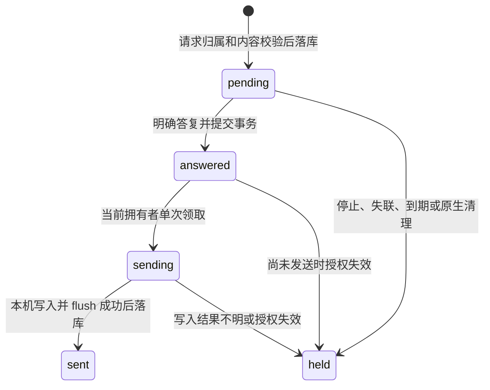

# MasterAgent 3.1 原生工具审批实施契约（设计，未实现）

日期：2026-10-19。状态：阶段 D 的后续实施契约；审批表、领域 API、原生答复和审批界面均未交付。当前 dev.3 的持久文本通道已使用 schema 5，`command` 与 `file_change` 均拒绝。用户已采纳先任务可见性、再持久文本通道的顺序；模型、用量及拒绝请求的公开观测不构成可批准的工具能力。审批须使用届时下一实际结构版本，不复用 schema 5。

本文补充 [3.1 方案](MASTERAGENT_3_1_PLAN.md)，供后续工具策略、持久审批和原生适配共同实施。正式能力状态和验收以 [3.1 进度](MASTERAGENT_3_1_PROGRESS.md) 为准。没有完成本文的部署策略与原生验证前置条件，不开放批准按钮，不仅通过修改 `approvalPolicy` 启用命令或文件操作。

## 1. 三种交互保持独立

| 对象 | 语义与作用域 | 对任务状态的影响 |
| --- | --- | --- |
| 平台 `Decision` | 业务流程是否继续，属于 installation、generation、task | 现有 `awaiting_decision`、重新排队或取消语义保持不变 |
| 运行中补充信息 | 属于一个 attempt 的文本纠偏；接收回执不等于采纳或授权 | 不替换原任务，不批准工具 |
| 原生工具审批 `RuntimeApproval` | 属于精确 attempt、原生进程连接、thread、turn、item、RPC 请求的一次工具答复 | 等待时 task/attempt 保持 `running`，member 保持执行归属；不得改成 `awaiting_decision` |

原生批准不能解除平台 Decision，平台批准和文本中的“同意”也不能产生原生工具答复。原生拒绝只拒绝该工具请求；不据此把平台任务标成失败或取消。停止任务仍走独立停止流程。

一个 attempt 只绑定一个由平台拥有的原生进程连接。连接丢失后不得把未结束审批搬到重连进程、另一个原生会话或新 attempt。未来若允许同一 attempt 重建连接，必须先增加连接代号及约束，不能仅复用 threadId。

## 2. 协议依据和归属

官方 App Server 使用服务端发起的 JSON-RPC 请求承载审批。请求和相关 item 需要按 thread、turn 归属处理；`serverRequest/resolved` 表示请求已回答或已清理，不能证明工具获批或执行成功。工具结果需另看匹配 item 的终态。[OpenAI App Server 审批文档](https://learn.chatgpt.com/docs/app-server#approvals)

本次设计同时核对了本机 `codex-cli 0.163.0` 导出的 schema：

`C:/Users/<用户>/Documents/Codex/2026-10-08/c-apphome-agent-fleet-docs-prompts/work/v31-runtime-20261019/native-schema/`

关键文件为 `CommandExecutionRequestApprovalParams.json`、`CommandExecutionRequestApprovalResponse.json`、`FileChangeRequestApprovalParams.json`、`FileChangeRequestApprovalResponse.json`、`RequestId.json` 及 `codex_app_server_protocol.v2.schemas.json`。这些 schema 是字段证据，不是已完成沙箱、权限或真实工具执行验证的证据。实际部署必须固定原生可执行文件和版本，升级时重新核对导出协议。

0.163.0 的命令请求还有 `kind`、`approvalId`、`environmentId` 等字段；同一个 item 可能对应多个回调，不能将 itemId 当作请求唯一键。`kind=writeStdin` 不是普通命令批准，本契约第一阶段不支持。原生 RPC id 的整数 `1` 与字符串 `"1"` 必须保留类型区别；禁止直接 `str(id)` 合并。

接收可批准请求前，controller 必须已确认本次 thread 和 turn，并见到匹配 item 的必要内容。turn/start 尚未确认、归属矛盾、内容不完整、未知请求类型或字段语义无法确定时，按拒绝或协议失败处理，不把原生请求自报的 turn 接纳为当前 turn。

## 3. 部署权限先于审批

工具授权由明确部署决定。有效权限只能是业务声明能力、角色部署权限、平台工具策略和实际 OS 隔离能力的交集。用户对一个请求的同意只允许在此交集内执行一次，不能放宽交集。

后续部署至少需要固定并校验这些信息：

| 配置 | 必须明确的内容 |
| --- | --- |
| 原生绑定 | runtime、可执行文件、固定版本、协议版本、模型、独立配置目录 |
| 工作区 | 安装/角色/代次、规范化工作区、读写上限、运行环境身份；不能因 cwd 相同推断身份 |
| 工具策略 | 支持的请求种类、精确展示与执行内容的绑定方式、单次授权、超时和不明结果处理 |
| 隔离与网络 | 子进程可访问的文件系统和网络边界，禁止绕过沙箱；配置声明须有实际行为验证 |
| 策略证据 | 不可变策略快照与 digest，绑定到 attempt；运行中变更不追溯扩大已有请求 |

平台策略不由业务包代码、UI 提交字段或原生请求中的权限建议定义。UI 命令只包含明确选择及作用域，不接受 `sandbox`、`permissions`、允许目录、可执行文件或规则修订字段。原生 `availableDecisions` 是协议可选项，不是平台授权清单。

当前决策是 `command` 与 `file_change` 均不开放；纯文本路由试点不以工具审批为前置条件。隔离与内容绑定通过后，优先评估完整、限大小、单次的 `file_change`，再独立评估 `command`；这是实施顺序，不是文件变更已安全或已获准启用。第一阶段平台选择只包含 `approve` / `reject`；满足全部前置条件时分别映射为原生单次 `accept` / `decline`。不开放 `acceptForSession`、执行规则修订、网络规则修订、会话授权、权限扩展、MCP 调用或动态工具。停止使用独立接口，不能用一个拒绝选择暗中替换为整回合取消。

存在 `networkApprovalContext`、额外网络/文件权限、规则修订要求、未知 environment 或 `writeStdin` 时，第一阶段一律不进入可批准路径。缺省字段的含义以固定版本协议为准；不能把字段缺失解释为无限权限。

命令的 `commandActions` 只是辅助说明，cwd 也不能约束命令的所有副作用。命令可通过子进程、重定向或其他路径访问资源。仅比较命令前缀、cwd 或字符串白名单，不能证明原生 `accept` 不会绕过隔离。可批准路径必须有独立可验证的执行边界；未建立此边界时仍拒绝。

### 文件变更不能只检查 grantRoot

本机 0.163.0 schema 将 `grantRoot` 描述为不稳定的会话余下期间写入请求，并注明其执行语义尚不明确。因此它不能作为一次文件变更的路径清单、授权证明或默认写入根。第一阶段发现非空 `grantRoot` 应拒绝，不把它转为单次批准。

文件批准应绑定同一 thread/turn/item 的已知 `fileChange` 内容，至少包含每项实际操作、路径、移动目标、完整可审阅差异及内容指纹。处理路径穿越、大小写/别名、符号链接、junction、UNC、重解析点和检查后替换的竞态；实际写入也须受部署隔离约束。缺少变更、超出完整展示上限、内容在答复前变化、不能确认文件边界时拒绝。`grantRoot` 为空同样不代表获得授权。

## 4. 后续结构版本的最小持久模型

推荐新增独立 `runtime_approvals` 表，不复用 `decisions`、`attempt_inputs` 或通用 outbox 作为授权状态。`attempt_events` 可记录公开证据，但不独自承担答案唯一性、投递归属和权限状态机。

| 字段 | 约束与说明 |
| --- | --- |
| `approval_id` | 平台生成 UUID，主键 |
| `installation_id`, `generation` | 必填；与 attempt 一致 |
| `attempt_id` | 必填，外键；task/role 由 attempt 关联，不信任提交方重复声明 |
| `request_key` | 原生 RPC id 的规范化带类型 JSON；同 attempt 唯一 |
| `kind` | 仅 `command` / `file_change` |
| `thread_id`, `turn_id`, `item_id` | 必填，原生已确认归属 |
| `policy_digest` | 此 attempt 不可变部署策略的 digest；不得按运行中最新配置扩大范围 |
| `details` | 规范化、限大小的精确请求快照，包含安全判断与完整展示所需字段；不得任意存整个原生 payload |
| `state` | `pending`, `answered`, `sending`, `sent`, `held` |
| `revision` | 初始 0；答案写入时加 1；用于用户答复并发检查 |
| `answer_id`, `choice` | 未回答为 null；回答后不可变，choice 仅 `approve` / `reject` |
| `created_at`, `answered_at`, `updated_at` | 持久时间；answered_at 未答为 null |

必需唯一约束：`UNIQUE(attempt_id,request_key)`；`UNIQUE(installation_id,answer_id) WHERE answer_id IS NOT NULL`。必须校验 referenced attempt 的安装和代次，不只依赖单列外键。

`details` 使用按 kind 定义的严格对象结构；包含原生 callback id、环境和适用版本等审核必需字段。设置总字节和条目数量上限，超限拒绝，不截断后仍允许批准。重复 request key 只有全部不可变字段一致才是重试；任何内容、item 或策略变化都是冲突。

原生请求关闭、item 最终状态及 held 原因可记录为专用 attempt events，以 approval_id 关联并使用白名单字段；它们不是新的授权。`sent` 不被改写成“已执行”。查询可组合成明确分层的公开状态。通用 outbox 仅携带 approval_id、attempt_id、状态及版本，不携带命令、补丁、凭据或私有推理。

引入审批的结构升级是写者兼容边界：当前 schema 校验要求精确表结构；增加审批后必须阻止旧版本继续忽略审批并完成任务。不能在原 schema 版本下偷偷增加授权语义。阶段 B 的路由账本预计先使用 schema 5；若确实先交付，审批使用其后的版本 N。N 在审批实现及冻结迁移清单时指定，不为编号把两个阶段捆绑交付。路由模型和顺序见 [持久路由与回执契约](MASTERAGENT_3_1_ROUTING_RECEIPT_CONTRACT.md)。

## 5. 状态机与传输语义



| 阶段 | 已知事实 | 不能推断的事实 |
| --- | --- | --- |
| `pending` | 平台保存了待答请求 | 用户批准、原生执行 |
| `answered` | 明确选择已持久化 | controller 已领取或原生已收到 |
| `sending` | 拥有者已领取一次发送资格 | 字节已送出、原生已处理 |
| `sent` | controller 观察到本机 pipe 写入及 flush 成功，并保存该证据 | 原生接受、工具执行、外部副作用成功 |
| `held` | 自动答复已停止，需核对 | 从未发送、工具未执行、可以安全重发 |

JSON-RPC 响应写入 transport 队列不等于 flush。发送线程必须把实际 flush 结果关联到特定 approval_id，再交给持有者落库。不能在 `transport.send()` 入队后立刻标 `sent`。

顺序必须为：审批请求先持久化；用户答复先提交；拥有者领取 `sending` 先提交；然后在事务外写原生响应；最后单独记录 flush 结果。不得持有 SQLite 写事务等待用户、等待管道或等待原生执行。

进程在领取后、入队后、flush 后但记账前退出，均可能留下 `sending`。恢复时进入 `held`，禁止自动重发，也不因“看起来未执行”改回 answered。此模型保证不盲目重放，不承诺跨进程 exactly-once 工具效果。

`serverRequest/resolved` 只增加“原生请求已关闭”的证据；它也可能来自回合清理。不能把它作为 approve 已被消费、flush 成功或工具执行成功的替代证据；不能凭它把 held 恢复为 sent。`item/completed` 的结果单独关联到精确 item，并保留 completed/failed/declined 的区别。

传输状态变化不递增答案 revision，确保 HTTP 回执丢失后的完全相同答复能返回原答案。held 后重复相同答案可确认之前已保存的事实，但绝不重新开放发送。新的不同答案、同 answer_id 换内容或换请求必须冲突。

## 6. 拟新增领域与公共 API

以下是待实现签名，不是当前可调用接口：

```python
request_runtime_approval(actor, attempt_id, lease_token, *,
                         request_key, kind, thread_id, turn_id, item_id, details)

answer_runtime_approval(installation_id, approval_id,
                        expected_revision, choice, answer_id, *,
                        expected_generation, expected_task_id, expected_attempt_id)

claim_runtime_approval_response(actor, attempt_id, lease_token, approval_id)

ack_runtime_approval_response(actor, attempt_id, lease_token, approval_id,
                              state)  # sent | needs_reconcile

runtime_approvals(installation_id, attempt_id=None)  # 只读历史
```

`request` 的策略来自该 attempt 可信且不可变的部署快照，不来自原生请求中的自报许可。controller 维护原生请求与 approval_id 的精确映射；claim 指明 approval_id，不能随手领取数据库中另一个 turn 的答案。

request、claim、ack 均核对原始 actor 与 attempt lease、安装/角色/代次、当前 task/attempt、原生成员归属、租约期限及不可变策略。新请求和新发送要求 task/attempt 正在运行、无停止或退出事件、原生请求尚开放。所有领域检查与写入位于同一事务。

公共 answer 不持有执行凭据，但必须在事务内核对 installation、generation、task、attempt、approval、expected_revision，并确认原 owner token 仍有效、member 可发布、租约有效、没有停止/退出/关闭证据、选择符合部署权限。`approve` 再次验证精确内容与策略；UI 显示的可操作标志只是提示，不能代替提交时校验。

幂等返回顺序：先检查明确作用域与安装代次，再匹配 answer_id 的原审批、原 revision 与原 choice；完全一致可返回已保存答案，即使同代次执行后来结束。此返回只确认历史写入。跨代次、跨任务、跨 attempt 不走此快捷返回。随后才检查新答案的 live/pending 条件。

公共命令新增独立 `native-answer`，字段精确限定为 `generation`, `task_id`, `attempt_id`, `approval_id`, `expected_revision`, `choice`, `answer_id`；不复用已有 `answer`。HTTP 与 CLI 共用领域服务，延续严格 JSON、同源、CSRF、请求大小和不明结果使用同 ID 重试的规则。

查询返回独立 `native_approvals`，以及 `can_answer`、`can_approve` 和不可操作原因；不混入平台 `pending_decisions`。读取不得领取、失效、关闭、重发或回执。历史代次可查看证据，不能答复。列表可只给摘要，完整内容按需读取；完整内容没加载或显示被截断时不能批准。

## 7. 运行中补充、停止和完成

审批等待不阻塞 controller 的主事件循环。继续读取原生事件、处理租约心跳、成员停止和运行中补充；不能把“等待用户”实现成阻塞读网页答复。补充文本使用现有独立投递顺序及回执，不能充当原生审批答案。

停止意图与关闭尚未完成审批必须同事务提交。pending/answered/sending 转 held，阻止新批准与新发送；已经 sent 的记录保留。controller 领取和实际写入前均检查停止、期限与拥有权，停止处理优先于新的批准答复。

数据库撤权与已进入 OS 管道的字节无法构成同一原子事务。需要定义并测试发送与停止的线性化边界：停止在发送门控前生效则不得发送批准；边界后可能已有响应在途，界面只能显示已请求停止及效果待核对。不得声称“停止按钮返回后工具必未执行”。最终仍由拥有者中断并确认原生进程退出；已发生副作用不自动回滚。

以下生命周期均需关闭审批发送资格：attempt 过期、member 被 fence、actor 撤销后的持有者失效处理、runtime 失联、原生请求关闭、turn 结束以及显式停止。member/attempt fencing 与 pending/answered/sending 转 held 同事务提交。无法再写入的旧拥有者不能绕过 fencing 来伪造送达。

`complete` 需新增未解决审批检查：存在 pending/answered/sending/held 时，禁止发布成功完成并进入需核对流程。正常 sent 记录只说明答复传输已记录，成功还依赖匹配原生 turn 终态、退出确认和现有完成检查。未知发送不能因出现一条最终文本就被当作已解决。

恢复业务、接续任务和重试 attempt 都不能重发旧原生审批。旧答案仅留作历史；新执行必须产生新的原生请求与新的审批。平台 Decision 原有代次重发规则不能套用到 RuntimeApproval。

## 8. 显式迁移规则

本契约仍未实施。真正实施时，按已发布结构确定源版本和新的目标版本 N，并提供明确迁移命令；阶段 B 已使用 schema 5，审批不得复用该编号：

1. 保留独立冻结的各已发布版本结构定义与 SQL fixture，包括 `V4_COLUMNS` 和阶段 B 实际发布的路由结构；所有受支持源版本均经已发布迁移链显式升级到 N。不能在 GET、查询、命令初始化或页面打开时迁移。
2. 在 `BEGIN IMMEDIATE` 内验证源库版本、完整结构及执行状态；任一 running task/attempt 均拒绝迁移。
3. 源库只要存在 ready/waiting/busy/stopping member 就拒绝迁移，不根据时间戳猜其进程已退出。先由原版本完成停止与确认，或明确处理失联，再迁移。租约登记和进程退出证据不能互相替代；若已有路由/投递，须先冻结新接纳与新领取，核对未确认 claim 和发送记录，不能在审批迁移中改写其归属或重发。
4. 保留一致 SQLite 备份后，在同一事务完成新增表、唯一索引、migration_log、必要的凭据撤销及 user_version 更新；最终结构和外键检查通过才提交。
5. 失败时回滚数据、表、索引、版本和凭据状态，保留可检查备份。再次 migrate 应返回明确的未发生迁移结果。
6. 需要审批结构的新写者遇到旧库要求显式迁移；旧版本遇到 schema N 必须拒绝，不允许忽略审批后继续执行或完成任务。回退使用隔离备份及匹配版本，不能原地降 user_version。只读旧结构支持需显式实现与测试，不能从新版本号推断其存在。

迁移不启动原生进程、不继承或复制个人认证、不接管旧 bus、不变更真实业务目录。使用合成业务和独立状态根验收后，生产迁移另行制定明确范围。

## 9. 预定代码接点

| 文件/位置 | 后续职责 |
| --- | --- |
| `masteragent/runtime_approvals.py`（拟新增） | 独立领域 mixin、规范化内容、幂等、领取/flush/held 和公开视图 |
| `masteragent/storage.py` | 实施时目标 schema N 的表/索引、已发布源版本验证、活跃执行与成员检查、显式备份迁移 |
| `masteragent/service.py` 的 `Platform`, `complete`, `fence_uncertain`, `expire_attempts`, `request_runtime_stop` | 注入领域能力；完成前检查和同事务关闭授权；不改变平台 Decision 状态机 |
| `masteragent/members.py` 的 `_fence_member` | 成员失去发布资格时同事务 hold 审批 |
| `masteragent/runtime_config.py`, `masteragent/deployment.py` | 独立工具部署契约、实际权限上限和不可变策略绑定；纯文本默认不变 |
| `masteragent/runtime.py` 的 runner callbacks | 把已拥有的 actor/attempt/lease 绑定到审批回调；不把凭据交给网页 |
| `masteragent/codex_app_server.py` 的 `_server_request`, `_notification`, `_Transport._writer`, supervisor 主循环 | 精确归属、item 内容绑定、非阻塞请求、单次答复、flush 证据、请求关闭/终态及停止竞态 |
| `masteragent/workbench_commands.py`, HTTP/CLI 路由 | 独立 native-answer 严格命令；不新增 UI 可写权限配置 |
| `masteragent/workbench_query.py`, `workbench_assets/` | 原生审批与平台决定分开展示，保持草稿与上下文，呈现保存/写入/关闭/执行各层事实 |

这些接点以函数名称为准，行号可能随本批观测代码变化。新增 API 名称和迁移实现尚未写入当前源码。

## 10. 端到端测试矩阵与启用门槛

| 测试层 | 必须验证的行为 |
| --- | --- |
| 领域并发 | 并发重复 request/answer/claim 各只有一条记录或一个领取者；相同 ID 换内容、换 item、换策略、换答案冲突；整数与字符串原生 id 不合并 |
| 归属与时效 | 错安装/任务/attempt/代次/actor/lease/member、租约到期、原生请求关闭、actor 撤销均不能新授权；同作用域的答案完全重试只返回历史、不重排队 |
| 状态独立 | 等待原生审批时 task/attempt 仍 running；心跳及补充可 claim/ack；平台 Decision 不能批准原生工具，原生批准不能解除平台 Decision |
| 进程与传输 | 落库前、领取后、入队后、flush 前后、flush 记账前分别注入故障；重启不重发 sending/held；不把本机 flush 或 serverRequest/resolved 当执行成功 |
| 停止竞态 | 答案保存与 stop、领取与 stop、发送门控与 stop、成员 fence 与 flush 回执竞争；先停止时禁止新发，已在途时保留不确定事实并确认进程退出 |
| 协议 | thread/turn/item/RPC 乱序、预确认请求、重复回调、同 item 多回调、原生清理、未知字段/方法、request 内容变化；不能借错误归属取得批准 |
| 权限负例 | session grants、规则修订、网络扩展、MCP、writeStdin、未知 environment、额外权限均拒绝；UI或原生请求自报允许无效 |
| 文件与命令 | 命令间接访问、子进程逃逸、外网请求、越界文件、路径别名/链接/重解析点/替换竞态、缺少 fileChange 内容、非空 grantRoot、超限或截断差异全部按边界处理 |
| 完成与恢复 | 未解决审批阻止成功完成；原生终态/退出仍独立检查；新 attempt、新代次、重新激活和业务切换不能沿用旧批准 |
| 公共接口/UI | HTTP/CLI 同规则；同源与 CSRF；明确选择；未加载完整内容不可批准；断网重试锁定原 ID；作用域切换不把旧答案写到新任务；查询零写、无凭据泄漏 |
| 迁移 | 冻结各已发布源结构、受支持源版本显式升级到 N、running 与活成员拒绝且不先改库、既有路由/投递冻结与核对、一致备份、晚期失败回滚、幂等、旧版本拒绝 schema N |
| 业务可替换 | 同构建空载→合成 A→合成 B→恢复 A；审批记录不跨业务/代次，基座没有具体业务或角色名分支 |
| 原生真实验证 | 使用明确独立验收目录和固定版本：工具确实等待、一次 approve/reject、等待时补充、停止、断线、外部边界负例、退出和结果链；仅替身测试不能标此项通过 |

阶段 D 的启用顺序是：部署策略与隔离验证 → 目标 schema N 与领域 → controller/传输 → 公共命令与 UI → 合成全链路 → 明确独立环境的原生验证。D 的隔离研究可与 A/B 并行，实际开放不能越过本契约的闸；纯文本阶段 B 无需等待 D。只有各层通过后才声明可批准工具。Claude 的请求格式、权限语义和真实验收必须独立完成；不因通用表或 Codex 契约完成而宣布 Claude 已支持。

本文完成只代表设计已记录。当前版本继续拒绝原生工具请求，不提供只能拒绝却标成“审批已接入”的界面，也不将拒绝观测计入工具授权验收。
