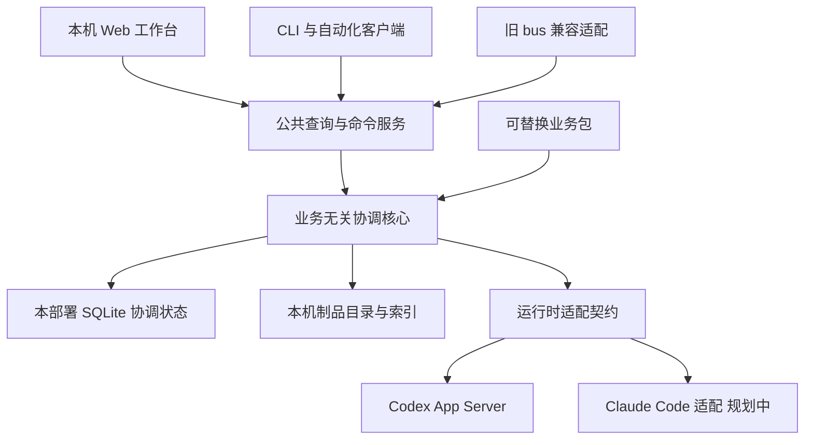

# MasterAgent 3.1 统一工作台与存储升级方案

日期：2026-10-19。状态：用户已采纳 [审阅取舍](ASTRA_3_1_REVIEW_DECISIONS_20261019.md)，实施顺序为 A 任务可见性与契约 → B 持久文本通道 → C 存储与可观测性扩展 → D 工具角色接入。A 已随 `3.1.0-dev.2.2` 完成；B 的路由与本机回执核心已随 `3.1.0-dev.3` 交付，schema 5、公共 API `3.1-dev1`。B 的旧入口适配和真实单角色→双角色文本试点仍待完成。既有只读工作台、公共操作、兼容导航和运行事实保留，正式发行仍为 3.0.0。实现和验收范围以 [3.1 进度](MASTERAGENT_3_1_PROGRESS.md) 为准；核心交付不等于旧 fleet 切换或整个 B 完成。

后续包号与放行门槛见 [版本路线与本机封包规则](MASTERAGENT_VERSION_ROADMAP.md)：`dev.4` 收齐 B 的入口适配、常驻搬运与独立真实文本试点，`dev.5` 对应 C，`dev.6` 对应 D，候选版核对完整 UI 去向和真实接入范围后再决定 `3.1.0` 正式发行。版本按验收推进，不预占 schema，不把 3.1 未完成承诺移入 3.2。已交付包统一归档到项目 `releases/`；封包不自动迁移状态或切换服务。

3.1 的目标是让用户在一个本机 Web 工作台中管理业务、团队、任务、结果和运行环境。Codex 与 Claude Code 使用共同的协调契约，各自保留原生执行与权限语义；平台状态和数据归属统一，业务继续可替换。

## 已确定的方向

- 用户确认以本机统一 Web 工作台为主要入口。
- 用户确认 Claude Code 暂不可用：现在完成接入设计、契约和不可用状态的处理，真实 Claude 与混合团队验收待环境恢复。
- 3.0.0 作为稳定基线保留。3.1 分批交付，不因界面升级自动接管正在运行的旧舰队。
- 业务可替换仍是硬验收：同一构建空载→业务 A→业务 B→恢复 A；具体角色、知识、流程与目录不进入平台分支。
- 数据默认留本机。此前仅限 3.0 验收目录的认证复用授权，不延伸到 3.1 部署。
- 先验证仅纯文本的持久单入口、领取排他和目的端回执，再迁需要工具的角色。`command` / `file_change` 当前均拒绝；审批不预占 schema 5，按实际结构交付顺序编号。

## 现状与改造重点

立项核查时，主目录 18 个 `masteragent/` 模块全部与 3.0.0 正式包一致；以下表格记录实施前的基线。发布后的接手工作增加了本机发行归档、源码打包和接管计划；这些是交付维护进展，不能作为生产切换完成的证据。参考 [接管工作态](MASTERAGENT_3_TAKEOVER_20261013.md)。

| 当前事实 | 3.1 的处理 |
| --- | --- |
| 3.0 已有 schema 4、Task、Attempt、成员租约、Decision、运行中补充信息和 outbox；结果与通知可同事务提交 | 延续这些能力，把它们接到统一工作台和公共服务，避免另造任务状态 |
| WebUI 仍直接依赖旧 bus，缺少 V3 的安装与代次上下文 | 新建明确绑定部署和业务的查询层，旧页面保留为标注来源的兼容入口 |
| `ui/server.py:169–183` 启动 UI 时同时启动维护、自愈等后台工作 | 将网页服务、协调执行器、运维守卫分别管理；查看工作台本身不触发接管或维护 |
| `ui/api.py:1638–1641` 的待办读取会同步并写回待办状态 | 查询只读；状态变更经公共命令入口提交 |
| 旧 bus 与 V3 尚无完整单入口路由和自动结果投递 | 建立持久 ID 映射、领取归属和投递回执，再逐批承接新任务 |
| 旧 UI 已有增量 DOM 更新、按可见页加载和 Codex 状态观察 | 保留有价值的机制，重整数据接口与页面组织，不把已有优化重新列成缺失功能 |
| V3 仅有 Codex 执行器；平台的实际模型和用量记录仍有缺口 | 用能力声明和实际证据驱动界面；未知显示未知，不能用旧 BI 数值填充 V3 执行 |

源码依据还包括 `ui/common.py:20–25`、`ui/api.py:21–26`、`masteragent/service.py:564–617`、`masteragent/runtime_config.py:145–146` 和 `masteragent/runtime.py:218,249–259`。这些是静态核查结论；本轮没有重测舰队实时健康或读取真实业务数据库。

## 用户工作流与界面结构

功能覆盖以 [界面功能迁移清单](MASTERAGENT_3_1_UI_COVERAGE.md) 为准。现有控制台有 21 个主页面及子模块；下面五入口重组导航，不据此静默取消原能力。后续按 [审阅分类](ASTRA_3_1_REVIEW_DECISIONS_20261019.md#21-个旧入口的暂定去向) 分为试点必需、兼容保留、独立扩展、待使用证据决定，不承诺逐页全量原生移植。dev.2 第一批增加“原功能目录”和本机操作说明，逐项保留原名称、覆盖状态和去向；显式配置本机旧控制台地址后提供对应链接。目录和链接不代表功能已完整迁入，也不证明旧服务在线；未等价承接项保留原入口，未收集使用证据的项目不自行退役。

采用五个主要入口，顶部始终显示当前业务与部署。用户从任务进入详情，在同一处查看进展、补充要求、处理待确认事项和打开成果。

| 入口 | 日常内容 | 主要操作或展示 |
| --- | --- | --- |
| 工作台 | 当前工作、需要用户处理的事项、异常、最近成果 | 优先呈现下一步需要处理的事情；每个状态显示来源与更新时间 |
| 任务 | 待执行、进行中、等待协作、已完成、需核对 | 任务列表与详情并排；详情含时间线、补充信息、决定、执行尝试和成果 |
| 团队 | 角色职责、当前任务、运行环境、接收状态与能力 | 区分已配置、可接单、忙碌、等待用户、失联、未验证；运行时和模型是独立字段 |
| 资料 | 业务包、角色工作态、成果文件、引用和版本 | 能追溯所属业务、任务、执行尝试、来源、实际存储位置和备份范围 |
| 运行设置 | Codex/Claude 连接、部署、权限、存储、备份、诊断 | 在同一流程中检查环境、登录就绪与支持能力；兼容控制台入口明确标注 |

界面约束：

1. 一个任务保留完整执行链，运行时切换产生新的明确执行归属。用户无需分别去 Codex 页和 Claude 页寻找同一任务。
2. 原生会话、平台任务和执行尝试分开展示；成员常驻不等于原生长会话，配置成功不等于真实可交互。
3. 执行中补充信息始终可见。分别显示已保存、已发送、已接收和无法确认；接收回执不冒充模型采纳。
4. 更新时保留选中任务、滚动位置、未提交文本和待处理问题。A 明确列表与详情各自的公开快照时间、失败和截断；持久游标及断线补读属于 C，完成前不宣称实时订阅或不漏事件。
5. 列表返回摘要与分页，详细正文按需读取。公开进度和最终结果可展示，原生私有推理内容不进入通用时间线。
6. Claude 当前显示“暂不可用，尚未真实验收”，并说明受限操作；不显示虚假的在线人数或成功状态。

dev.1 对实际模型和用量显示未采集。dev.2 第一批接入本部署、所选业务及代次已有的公开执行记录；第二批采集服务端模型报告及 token 累计用量。`model_requested`、`model_reported` 和 `model_observed` 分列，服务端配置或改道目标不是后端实际推理证据，实际模型仍为未知。用量只取已持久化的公开计数，显示通知来源与本次新建原生会话累计范围，不代表单轮增量或账户总额度。缺失不能填 0，也不能拼接旧 Claude BI 数据冒充本次执行。最近执行证据不代表当前连接或登录已验证。

## 公共服务与两种运行时

UI、CLI 和兼容适配器使用同一组领域命令与幂等规则；前端和业务包不直接修改数据库或旧邮箱文件。前后端通过明确的数据契约解耦，当前前端使用随包交付的原生 ES 模块，后端延续 Python 协调核心。dev.2 第一批的 HTTP/CLI 已共用四项公共命令；旧 bus 的领域兼容适配仍待后续交付，当前兼容入口只负责导航。

需要明确区分四层：

| 层次 | 责任 |
| --- | --- |
| 业务包与角色 | 指令、知识、流程、通用能力；保持可移植 |
| 部署与连接档案 | 原生版本、模型、账户引用、工作区、权限和可用状态 |
| 平台任务与执行尝试 | 领取、租约、补充信息、决定、结果、停止、恢复和通知 |
| 原生会话绑定 | runtime、精确 session/thread/turn、安装/角色/代次、宿主方式与恢复能力 |

运行时类别与宿主方式也是两件事：平台管理的独立执行器和已存在的 CLI/桌面会话分别声明能力。旧会话只能通过其明确的兼容通道观察或操作，不能因名称相同或共享进程就推断身份。

Codex 沿用 App Server 路线。Claude 的深度接入优先按官方 Agent SDK 设计，CLI 作为兼容边界；其原生事件、取消、审批和会话恢复分别适配，不机械翻译 Codex 参数。两种适配器共用任务生命周期、公共事件、错误分类和能力测试。

官方资料说明 Codex App Server 提供线程/回合、流式事件、原生恢复和审批请求；这些原生接口存在，不代表 V3 已实现全部能力。[Codex App Server](https://learn.chatgpt.com/docs/app-server)

Claude Code 提供结构化和流式输出；官方 Agent SDK 用于把其执行能力嵌入自有应用。当前项目对这些能力的真实适配仍待实现和验收。[程序化运行](https://code.claude.com/docs/en/headless)、[Agent SDK](https://code.claude.com/docs/en/agent-sdk/overview)

每项能力分别记录“有官方依据、契约测试通过、原生验证通过”。补充输入、人工审批、文件工具、原生恢复和用量统计均由能力声明决定是否开放。不支持的操作给出具体原因，不通过跳过权限来伪造一致体验。

3.0 的正式执行范围仍是纯文本。3.1 的深度接入需单独交付工作区工具配置、原生审批桥和 agent 协作工具契约：请求绑定精确执行与权限范围，迟到、重复或跨角色答复不得改变其他执行；运行中的协作请求明确等待或继续执行的语义。保留可复现的纯文本配置，新增能力按独立配置验证。原生恢复与平台任务接续分别验收，不能只增加界面按钮便宣称支持。

跨运行时接续通过精简工作态、任务结果和明确制品引用完成。Codex thread 与 Claude session 不互相原生 resume；旧代次身份和未确认执行继续受原有隔离约束。

### 认证与部署体验

把账户连接档案、角色部署和会话历史分别建模，避免用户误以为每创建一个角色都要新建账户登录。连接页先检查指定运行时与账户引用，解释“未安装、未登录、版本不兼容、能力未验证”等具体原因；同一连接的登录操作去重。

认证复用必须使用该原生运行时实际支持且已验证的机制。设计阶段不承诺任意 home 共用登录，也不把复制认证文件做成默认实现。普通状态库、业务包、界面正文和通用导出只保存非秘密引用。此项作为 3.1 部署体验专项验证。

## 存储层方案

默认继续采用**每个独立 state-root 一个 SQLite 权威事务库，加本机文件制品**。同一部署按 installation 隔离业务，多个独立部署只做带来源标记的只读聚合。数据库类型的变化不能替代任务所有权和回执协议。

| 数据类别 | 保存位置与规则 |
| --- | --- |
| 任务、Attempt、成员、决定、输入、结果、outbox | 复用现有事务库和领域约束，核心状态只有一个授权写方 |
| 兼容路由与投递账本 | 增加旧消息 ID 与新对象映射、路由代次、去重键、接纳阶段和目的端回执；事务内提交相关状态 |
| UI 观察与审计事件 | 相关状态变更同事务写事件序号、对象 revision、因果关系和最小数据；供分页、增量订阅与断线补读 |
| 文件成果与大型资料 | 显式本机制品根；数据库保存归属、相对引用、大小、摘要、状态和保留规则，界面只展示已完成封存的制品 |
| 原生历史与认证 | 各运行时管理；平台保留经过授权的精确引用及能力，认证不进入通用备份或业务包 |
| 业务包与发行包 | 可移植业务定义和不可变平台发行分别保存，不混入在线队列和临时运行数据 |

进一步约束：

- 保留状态表作为操作依据，事件承担观察与审计，不为 3.1 强制重写为全量事件溯源。
- 现有 outbox 扩展到每个目的端的持久投递证据。产生结果、排队、目的端接收、agent 处理和用户已读是不同阶段。
- 文件封存与数据库登记不是天然的跨资源事务。明确暂存、校验、ready 和异常核对步骤；崩溃后的孤立文件先记录，不能自动删除。
- 界面按快照和持久游标续读，watcher 只负责唤醒。游标过期时明确重取快照，不能默默漏掉事件。
- 当前存储明确拒绝 WAL，属于现有只读和文件边界契约。先测查询、事务及锁等待，再决定存储模式，不能顺手开启 WAL。
- 本机数据库服务、Redis 或多机写入只有出现明确部署或容量需求时再引入。本轮未测容量瓶颈，不编造性能结论。
- 备份分别标明源码发行、协调状态和业务资料的覆盖范围。恢复需在独立目录核对任务、投递阶段、制品摘要与归属；源码 ZIP 不等于在线数据恢复备份。

路由的不可变来源身份、所有领取入口排他、目的端幂等持久接收与查回执、长文本上限、fencing、held、迁移和回退规则冻结于 [持久路由与回执契约](MASTERAGENT_3_1_ROUTING_RECEIPT_CONTRACT.md)。B 的来源映射与新 Task 同一核心事务提交；跨源/目的端存储域靠同 ID 核对衔接，不承诺跨域 exactly-once。旧 outbox 的 delivered 不迁成目的端 received。

## 分批交付

### 已采纳的后续实施顺序

以下顺序从 2026-10-19 起替代原 dev.2/dev.3 的剩余交付排序，保留原批次及其已完成事实。A 已完成；B 的核心/本机参考目的端已实现，旧入口适配和真实试点尚未完成；C/D 是有前置条件的后续工作。开发包、正式发行和旧 fleet 灰度切换分开验收。

| 阶段 | 交付范围 | 放行条件与边界 |
| --- | --- | --- |
| A 任务可见性与契约 | 稳定跨代任务链与有界历史分页；保存后交接提示；平台决定分名；详情独立快照时间；冻结路由/回执及 API 兼容规则 | schema 4；原详情仍按 dispatch 代次过滤；历史只读不放宽写守卫；纯排队续接、旧决定/尝试、两次以上续接、分页截断、跨安装隔离和旧客户端兼容验证 |
| B 持久文本通道 | 已实现核心来源映射、路由 epoch、已接入来源的旧/新领取排他、本机目的端幂等接收/查回执、三类独立冻结、held 核对及显式迁移；旧 fleet 全入口接入仍待实施 | 已使用 schema 5，完成合成并发、事务故障点、重复/迟到回执、长文本和目的端身份验证；仍须全部参与入口适配及单角色→平台预编排双角色真实纯文本试点；无模型自主派活 |
| C 存储与可观测性扩展 | 持久事件游标、断线补读、制品封存与索引、输入来源、备份范围和历史查询扩展 | 复用 B 权威账本；文件封存与数据库提交的崩溃恢复单独验证；不能等 C 完成才处理 B 的超限正文，B 已须明确拒绝或核对 |
| D 工具角色接入 | 可验证隔离、不可变工具策略、独立 RuntimeApproval、精确内容/发送证据、真实工具验证；Claude 独立适配 | 两类工具在准入闸通过前均拒绝；优先评估单次 file_change，再评估 command；schema 使用当时的下一实际版本，不预占 5；审批不能复用 Decision |
| 候选版与灰度 | 已验收能力的可部署包、操作说明、21 项能力去向和消费方说明；由运行负责人限定新任务范围逐批接入 | 同构建空载→A→B→A；真实消息进出、纠偏、停止、回执和恢复；切换前核对在飞工作，回退只改变未接纳的新消息去向 |

A 界面、B 领域设计和 D 隔离研究可以并行；B 真实试点必须在持久排他与回执故障验证之后。D 无须等待 C 全部结束，但不能跳过隔离、内容、领域和发送竞态验收。需要工具的角色此前继续留旧线。Claude 暂不可用不阻塞 Codex 纯文本试点；真实 Claude 与混合团队仍单独放行。

### 原立项批次（历史范围）

下表保留立项时 dev.1/dev.2/dev.3 的范围，不再作为未完成项的执行优先级；原 dev.2 未完成的工具与审批移至 D，原 dev.3 的持久通道先做 B、其余扩展在 C。未完成范围没有因重排而完成或被取消。

| 批次 | 可交付结果 | 放行标准 |
| --- | --- | --- |
| dev.1 统一契约和只读工作台 | 明确部署/安装上下文；任务、成员、待确认、连接状态的查询契约；五入口骨架与合成样例；Claude 不可用展示 | 打开/刷新/切页均不写业务状态、不启动运维；未知值不冒充零；A/B 切换无数据串用；列表分页、断线和空态有验证 |
| dev.2 公共操作与运行时接入 | 提交任务、运行中补充、答复决定、停止、结果通知；Codex 适配与实际模型/用量观察；独立工具配置、原生审批与协作桥；Claude 契约适配 | UI/CLI 共用幂等与授权规则；重复点击不重复执行；待确认输入不会静默丢失；合成工作区和工具的范围限制、审批归属有验证；真实 Codex 闭环与替身测试分开记载 |
| dev.3 存储与兼容通道 | 版本化增加路由映射、投递、会话引用、制品索引及事件查询；迁移预演与备份恢复工具 | 用临时根验证崩溃点、重复/迟到回执和文件封存中断；每条新任务只有旧或新一个领取方；恢复后逐项对账 |
| 候选版与灰度 | 完整工作台、可部署包、操作手册；由运行负责人按明确业务和角色逐批接入 | 同构建空载→A→B→A；真实消息进出、纠偏、停止及回退；切换前核对在飞工作，回退只改变后续路由 |

Claude 暂不可用期间，dev.1 至 dev.3 的公共设计、界面和契约验证可以继续。发布记录必须单列 Claude 的真实验收缺口；不能把 Codex 或替身成功宣称为混合团队通过。环境恢复后，先验证 Claude 独立闭环，再验证两种运行时之间的任务交接。

候选版另列连接与恢复体验清单：账户连接复用是否经官方机制实测、角色与历史作用域是否隔离、同运行时原生恢复是否可用、跨运行时工作态交接是否完整。未完成项保留具体受限原因，不以“统一入口”代替这些能力的验收。所有前端资源随本机发行包交付，默认只监听 loopback，不依赖运行期外部 CDN。

候选版还须逐项核对 21 个旧 UI 入口、嵌套功能及跨页交互。每项分别标记“新实现通过”“兼容入口可达”或“未完成”，不按菜单数量计算覆盖率。历史用量、上下文、提示词审核、角色生命周期、工作组、任务线/长程任务、存储与路径、语音扩展和高级诊断均不得因导航归并静默丢失。独立 TODO 与执行任务、旧手动回填与 V3 结果提交要明确语义，不能直接合并。

## 第一批实施范围

dev.1 以公共查询契约与只读工作台为范围，实施结果见 [工作台说明](MASTERAGENT_3_1_WORKBENCH.md)：

1. 列出各对象的权威来源、标识、revision、更新时间和可执行能力，冻结查询 DTO；明确旧 bus 与 V3 的来源区别。
2. 以显式选定的状态根提供有界查询，界面不调用旧 `build_state/_sorted_todos` 来拼接 V3 状态。
3. 建立任务列表及详情、成员状态、待确认事项和运行连接卡，使用合成业务验证交互；成果和存储页先明确已有与待实现能力。
4. 网页服务与执行/运维生命周期分离。静态预览、查询 API 和真正的运行控制分别测试，默认查看不执行任务。
5. 用两个不同业务、同名角色、不可用 Claude、断线和过期状态完成隔离验收；通过后再开放 dev.2 写操作。

立项阶段只做静态审查。dev.1 实施在独立合成状态根中启动本机只读预览，没有复制认证、调用模型、读取私有会话、修改生产状态或迁移旧队列。3.0 发布与接管记录继续保留；3.1 的进度单独维护于 [3.1 进度](MASTERAGENT_3_1_PROGRESS.md)。

## dev.2 第一批交付与剩余范围

这一批完成公共操作、现有执行证据展示和旧入口可达性，保留原定 dev.2 的历史范围，不能据此将整个阶段标为完成；剩余项按上面的 A→B→C→D 顺序推进。

| 已实现内容 | 边界与验证 |
| --- | --- |
| 21 项原功能目录、本机帮助、显式旧控制台链接 | 用 `--legacy-console-url` 配置本机 HTTP 来源；不探测、不启动旧服务，不合并新旧队列。完整旧 UI 迁移仍按清单逐项验收 |
| `submit`、`input`、`answer`、`stop` 共用命令服务 | 工作台默认只读，显式 `--enable-commands` 才开放写入口；命令在领域事务内校验当前业务、代次、任务与执行归属，并保留重复请求语义。提交任务不会启动执行器 |
| 操作可用性与表单状态 | 根据当前代次、租约及运行记录禁用不可用操作；提交回执不明时保留原内容和标识。补充文本不是批准，公共决定不是原生工具审批，停止回执只确认请求已保存 |
| 执行与通知公开事实 | 展示持久化的运行时、thread/turn、请求/实际模型、公开用量及有界通知元数据；缺失值保持未知。读取通知不回执，outbox 的 delivered 不等于用户已读或模型已接收 |

2026-10-15 第一批自动化验证：Python 全套 435 项检查用时 148.2 秒，434 项通过，1 项因 Windows 软链接权限跳过；前端 27 项和旧入口导航 3 项通过。此处保留当批结果，不作为后续批次复测证据。浏览器验收记录、交付包和最终放行结论由 [实施进度](MASTERAGENT_3_1_PROGRESS.md) 汇总。

本批未新增真实原生运行验收，未读取认证或私人历史，未接管生产服务。独立工具配置、原生工具批准与协作桥、Claude 真正适配、完整旧 UI 取舍仍待后续；存储、持久投递、制品索引和数据库迁移的剩余范围已重新排列为 B/C，工具与审批为 D。

## dev.2 第二批交付与下一步

`3.1.0-dev.2.1` 增加运行事实采集和展示，保留纯文本部署与现有 schema 4。新增 `runtime_observation` 和 `runtime_native_request_denied` 公开事件；查询按执行和代次投影，界面保留字段来源与未知状态。拒绝事实只记录方法与原因，不保存命令、补丁或原始协议载荷。

| 第二批实现 | 后续仍需完成 |
| --- | --- |
| `thread/start` 配置报告、`model/rerouted` 改道目标与独立来源字段 | 后端实际推理模型仍无独立证据，不将服务端报告填入 `model_observed` |
| `thread/tokenUsage/updated` token 计数与 `fresh_thread_total` 范围 | 历史趋势、跨执行汇总、账户额度及 Claude 用量仍需独立口径和来源 |
| 公开原生请求拒绝事件、详情计数与帮助说明 | 业务工具、人工原生批准和协作桥未开放；默认只读工作台不变 |
| [原生工具审批实施契约](MASTERAGENT_3_1_NATIVE_APPROVAL_CONTRACT.md) | 契约是设计而非实现；审批表、原生答复和按钮暂不执行，须先落实工具部署与可验证隔离边界；结构版本按落库顺序确定，不预占 schema 5 |

字段与响应形状核对本机 `codex-cli 0.163.0` 导出的 schema，审批语义参考 [OpenAI App Server 文档](https://learn.chatgpt.com/docs/app-server#approvals)。这只作为协议依据；本批没有新增真实 Codex 模型验收，Claude 和混合团队仍未验收。原 3.0 验收目录的认证复用授权不延伸到本次 3.1 工作。

第二批测试数量、浏览器结果和构建摘要统一记录于 [实施进度](MASTERAGENT_3_1_PROGRESS.md)。原先“先工具策略和审批、后持久存储投递”的后续安排已由本次 A→B→C→D 顺序取代；不将运行事实采集视为整个 dev.2 原始范围已完成。

## 阶段 A 的契约与后续放行

A 的任务链使用独立只读入口，不改原详情的所选代次含义。配置增加契约修订号和 `task_history` 能力声明，公共 `api_version` 保持 `3.1-dev1`；旧客户端忽略附加字段，新客户端在旧服务没有能力声明时不请求新入口。任务链参数、公开字段、分页作用域和版本变更规则见 [API 兼容契约](MASTERAGENT_3_1_ROUTING_RECEIPT_CONTRACT.md#9-阶段-a-公开-api-兼容契约)。合同冻结与代码验收分别记载，不以 DTO 设计证明功能通过。

B 的真实试点先使用专用虚构文本完成单角色闭环，再由平台控制方预编排双角色父子任务。验收来源身份、所有入口排他、执行中补充、停止、断线不明、完整结果及目的端持久回执；不让模型自主派活，不读私有历史或认证，不复用 3.0 授权。合成实现与证据完成后，再明确本次认证范围；真实业务灰度时再明确消费方及新任务范围。

冻结新接纳、禁止新 claim、停止现有 member 是三个不同动作。当前 member stop 会 fence 活跃 Attempt，不是自然排空。回退只改变尚未接纳的新消息，已有消息、结果及 held 保留原归属和核对责任；不搬回旧 inbox，不覆盖新库，不重放旧成果。完整故障点与回退清单见 [路由契约](MASTERAGENT_3_1_ROUTING_RECEIPT_CONTRACT.md#10-阶段-b-验收试点和未实施边界)。
